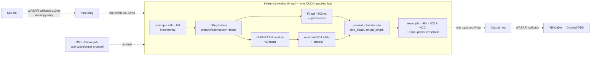

# 00 — Research Index

**Project goal.** An ultra-low-latency real-time RVC voice changer for a single user's voice
(male→female), Windows + NVIDIA CUDA, Python: mic in → converted female voice out of a virtual
cable (usable as a microphone in Discord/OBS/games), with quality tuned once to one user, one mic,
one GPU. Latency targets: **~175 ms conservative V1, ~110 ms aggressive, 75–90 ms stretch**.

**Research scope & method.** Source-level inspection of four reference codebases —
**w-okada/voice-changer**, **Applio** (`rvc/realtime/`), **Vonovox** (compiled; README/strings),
and **RVC-WebUI** (canonical `realtime_gui.py` + `infer/rtrvc.py`) — plus the relevant papers
(RMVPE, FCPE, SwiftF0, CREPE, ContentVec) and targeted web search. Claims are tagged
PROVEN / LIKELY / EXPERIMENTAL and cited to file+line throughout docs 01–11.

---

## Document map

| Doc | Title | One line |
|---|---|---|
| 00 | Research index | this file — entry point, conclusions, 25 answered questions |
| 01 | Reference projects | source-level survey of the four codebases; what to copy and what not to |
| 02 | RVC pipeline | the canonical inference math: sample-rate map, f0_to_coarse, protect, skip_head/return_length |
| 03 | Realtime audio architecture | chunking, rings, SOLA, VAD state machine, backends, threading; our decoupled design |
| 04 | Latency analysis | the full latency model, algorithmic vs compute, budgets, bottleneck ranking, profiler design |
| 05 | F0 research | RMVPE/FCPE/SwiftF0/CREPE/classical compared; context floors; the rolling pitch cache |
| 06 | GPU optimization | CPU↔GPU boundary map, CUDA graphs, precision policy, torch.compile/ONNX/TRT verdicts |
| 07 | Index & features | HuBERT cost/caching analysis; FAISS index math, GPU brute-force replacement |
| 08 | Voice personalization | single-user calibration, M→F science, protect/pitch math, profile schemas, tuning loop |
| 09 | Model formats | .pth/.index/ONNX anatomy, metadata auto-detection algorithm, models/ layout |
| 10 | Benchmark system | stream simulator, perf/quality sweeps, metrics with caveats, regression gates |
| 11 | Tech stack | Python 3.12 + torch 2.7/cu128, sounddevice, pins, JSON profiles, packaging plan |
| 12 | **Project structure** | the repository layout and module contracts to start development from |
| 13 | Implementation roadmap | 10 phases from skeleton to packaging, each with acceptance + benchmark gates |
| 14 | Open questions | 13 unresolved items, each with a concrete test and a decision deadline |
| 15 | Modernization report | 2026-10 audit of main@2b2cf93 plus ~100 external sources: what to keep, a three-phase plan (measure, inference-time fixes, retrain, distil) |
| 16 | Audio analysis brief | 2026-10-17 status of the stutter hunt (raw-mic matrix results) and a research brief: tools that let an AI locate artifacts in the audio |

---

## Most important conclusions

1. **Latency is dominated by terms you choose, not GPU speed**: hop accumulation + SOLA overlap +
   output buffering are 70–90% of end-to-end; compute only matters through `p99(T_compute) < hop`
   (doc 04).
2. **The chunking law is universal and settled**: `convert = extra + crossfade + sola_search + block`,
   padded to 160-sample multiples @16 k, with `skip_head`/`return_length` so the decoder vocodes
   only the tail — copy it, don't reinvent it (docs 02/03).
3. **Decouple callback from hop** — the one thing no reference does: ≤10 ms callbacks feeding
   rings, a worker thread running a 20–32 ms hop. This is our main latency edge (doc 03 §10).
4. **EXTRA history is latency-free but compute-expensive**: 0.5 s (Applio default), not 2.5 s
   (rvc-webui default) (docs 04/07).
5. **F0 caching is proven**: rolling pitch cache, tail-only recompute (~310 ms RMVPE / 300 ms FCPE
   floors), `[3:-1]` boundary trim — two independent codebases (doc 05).
6. **HuBERT cannot be cached**: bidirectional attention invalidates KV caching; full-window
   recompute every hop is the (universal) state of the art (doc 07 §A.4).
7. **CUDA graph capture of the whole hop is the highest-leverage optimization** — eliminates
   hundreds of kernel launches/hop; requires pointer-stable preallocated buffers, warmup×3,
   keyed cache, eager fallback, restart-on-capture-failure (doc 06).
8. **Replace FAISS at query time with torch brute-force on GPU** (`addmm`+`topk`, k=8, 1/d²
   weights); faiss-cpu only for file loading + OOM fallback — faiss-gpu has no Windows wheels
   (docs 06/07).
9. **M→F = measured transposition + model quality, not formant hacks**:
   `f0_up_key = round(12·log2(F0_target_median/F0_source_median))` from calibration; timbre and
   formants come from the trained decoder (doc 08).
10. **One user → constants, not sliders**: calibration + offline tuning write JSON profiles; the
    engine takes a profile; the benchmark feeds the identical engine (docs 08/10/12).

---

## Recommended architecture at a glance

## Recommended V1 target list

Windows 10/11 · NVIDIA CUDA (cu128, torch 2.7.x, Python 3.12) · RVC v2 `.pth` (v1 supported) ·
ContentVec embedder · RMVPE default + FCPE alternate (SwiftF0 experimental) · sounddevice/WASAPI
shared (exclusive flag) · small hop + circular history buffers · SOLA stitching (phase-vocoder A/B) ·
GPU-first pipeline (one upload, one download per hop) · voice profile from one-time calibration ·
built-in profiler (CUDA events + p99 gates) · optional GPU brute-force index (default off) ·
VB-Cable/VAC output pinned at 48 kHz · headless engine + thin JSON control API (GUI later).

**Unresolved questions:** see doc 14 (13 items, each with a test and a phase deadline — notably
minimum stable hop, EXTRA sufficiency, FCPE-vs-RMVPE on this voice, overlap/phase-vocoder choice,
and tuning-objective validity).

---

## The 25 most important questions, answered

1. **What is the lowest-latency architecture?** Small WASAPI callbacks decoupled via SPSC rings
   from a worker thread running a 20–32 ms hop over a sliding context window, the whole GPU hop
   CUDA-graph-captured, SOLA-stitched into an output ring feeding VB-Cable. All four references
   couple hop == callback block; decoupling them is the main win (doc 03).
2. **What sets the minimum chunk/hop size?** The stability inequality `p99(T_compute) < hop` with
   ~1.5× headroom, plus RVC's 20 ms feature granularity (HuBERT hop 320 @16 k) and SOLA overlap
   quality floors (~16–20 ms). Compute savings buy smaller hops, not directly lower latency (doc 04).
3. **Can the callback block be smaller than the model context?** Yes — callback block is a
   transport unit, model context a sliding window over ring history; they must be independently
   configurable. That is precisely the ring + worker design (doc 03 §1).
4. **How much context does RMVPE need?** Hard floor one 32-mel-frame tile ≈ 320 ms; both canonical
   realtime implementations feed `block+800` rounded to `5120n−160` → ~310 ms tail (doc 05).
5. **How much does FCPE need?** One STFT frame technically; 4800 samples (300 ms) as the proven
   quality floor (Applio's "chunk duration should control latency, not pitch quality") (doc 05).
6. **Can F0 be cached?** Yes — PROVEN twice: rolling pitch/pitchf rings, shift by `block/160`,
   write fresh frames trimmed `[3:-1]`, recompute only a ~300 ms tail per hop (doc 05 §3).
7. **Can HuBERT features be cached?** No. Attention is bidirectional, so a KV cache is invalid;
   every reference recomputes the full window. Only EXPERIMENTAL paths exist (exact conv-frontend
   caching ~10–20%; approximate feature rings — unproven) (doc 07 §A.4).
8. **Where is unnecessary recompute today?** The references recompute full-window HuBERT with
   oversized EXTRA (2.5 s), decode the context region (fixed by skip_head), recompute F0 over the
   whole window (w-okada), and resample whole buffers; our design keeps only the irreducible
   full-window HuBERT at EXTRA 0.5 s (docs 03 §3, 04 §4).
9. **What is the CPU↔GPU transfer map?** One upload (fresh mic hop) and one download (final hop
   audio) per hop, plus one scalar gate sync; everything between — resample, F0, HuBERT, retrieval,
   synth, RMS, SOLA — stays device-resident. The canonical pipeline's 4–7 syncs/hop (FAISS
   round-trip, numpy F0, librosa RMS) are the anti-pattern (doc 06 §1–2).
10. **Can the index run on GPU?** Yes via torch brute-force L2 (`addmm`+`topk`) over the
    reconstructed vectors — exact, sub-ms, graph-capturable (Applio `IndexWrapper`). faiss-gpu: no —
    no official Windows wheels; faiss-cpu stays only for loading `.index` files and OOM fallback (docs 06 §9, 07 §B).
11. **What does the index cost?** VRAM = ntotal×dim×4 B (cap/subsample >~200 k vectors); ~0.1–1 ms
    per hop for k-means-reduced indexes; quality benefit is model-dependent — default off, with an
    auto-benchmark at model load (doc 07 §B).
12. **How much latency does SOLA add?** overlap + search emitted behind the newest synthesis:
    ~16–30 ms at our settings (20–32 ms overlap capped ≤40 ms, 10 ms search). Compute is ~0 on GPU
    (doc 03 §4).
13. **What is the concurrency model?** Two PortAudio callbacks (memcpy only) + one inference worker
    thread (torch releases the GIL) + a control thread; bounded drop-oldest transport; Applio's
    process isolation held as the escape hatch if p99 shows GIL stalls (doc 03 §9).
14. **Do CUDA graphs help?** Yes — the single highest-leverage optimization, proven independently
    in rvc-webui and Applio; replay collapses hundreds of launches to one. Preconditions: static
    shapes, preallocated pointer-stable buffers, no host ops inside, warmup, eager fallback,
    restart-on-capture-failure (doc 06 §11).
15. **ONNX for V1?** No. Whole-model ONNX with host I/O (w-okada) is slower than graphed torch;
    decoder-only ONNX (Applio) is roughly a wash. Keep the decoder seam; adopt only if profiling
    shows the decoder dominating (doc 06 §7).
16. **TensorRT?** No — 10–30% on sub-dominant modules vs per-model engine builds and Windows
    packaging pain; no reference uses it. V2 candidate for the static HuBERT encoder only (doc 06 §8).
17. **What are the key M→F settings?** Measured transposition (`round(12·log2(target/source))`,
    validated ±1 st by ear), a well-trained female target model (which supplies formants, sibilants,
    breathiness), protect ≈ 0.33 when index is on, calibrated F0 clamps + RMVPE for octave hygiene.
    Not formant hacks: input warping is ignored by ContentVec, output warping detunes trained
    formants (doc 08).
18. **Which parameters are learnable/tunable per user?** f0_up_key, F0 min/max clamps, extractor
    choice (by measured octave-flip rate), input gain, gate/VAD thresholds — from calibration;
    index_rate, protect, volume_envelope — from the offline tuning sweep + human A/B; block/extra —
    from the GPU perf benchmark (doc 08 §1).
19. **What is the calibration architecture?** A 45 s guided 4-pass recording (silence/read/
    dynamics/edge material) through the production input chain, analyzed with the shipped RMVPE,
    writing five JSON profiles (voice/calibration/device/runtime/model-overrides); recordings
    double as the benchmark quality corpus (doc 08 §4–5).
20. **How is quality-vs-latency benchmarked?** WAV files through the *identical* engine via a
    stream simulator (throughput mode for cost, paced mode for underruns); perf sweep first, quality
    sweep on locked winners; gates on p99-vs-budget, underruns, F0 stats, WER, speaker-cos,
    log-mel diff; human A/B is the final arbiter (doc 10).
21. **What should we copy from Applio?** GPU index wrapper, whole-hop CUDA graph pattern +
    invalidation, VAD/gate state machine with tail-drain + onset fade, warmup protocol, FP16-HuBERT
    autocast, phase-vocoder crossfade (A/B), measure-then-size block rule, decoder-ONNX seam (doc 01).
22. **From rvc-webui?** The canonical realtime math: zc unit sizing, GPU ring buffers, incremental
    resampling with overlap-discard, pitch cache `[3:-1]`, `skip_head/return_length` decoder
    trimming, GPU SOLA, the honest latency readout, the graph-support probe (doc 01).
23. **From w-okada / Vonovox?** w-okada: model-slot metadata auto-detection, per-model persisted
    defaults, ONNX metadata convention, silenceFront concept. Vonovox: product guidance — VAC/cable
    pinned 48 k, "Listen to this device" monitoring, Silero VAD 400 ms release, RNNoise option,
    SwiftF0 viability (doc 01).
24. **What must we NOT copy?** Inference inside the audio callback (rvc-webui), Socket.IO/WebSocket
    transport for local audio, CPU int16 SOLA and resampy-per-block (w-okada), k=1 index, huge
    default buffers (683/512 ms blocks, 85–100 ms crossfades, 2.5 s extra), per-block
    `empty_cache`, blocking output-queue `get()`, ignoring callback status flags (docs 01/03/04).
25. **Where is the repo structure?** Doc 12 — `src/vox/` with hot path (`audio`, `pitch`,
    `features`, `retrieval`, `synthesis`, `engine`, `profiling`) and control path (`models`,
    `calibration`, `config`, `offline`, `api`), an empty `ui/` behind a JSON control surface, and
    the build order in doc 13.

---

## Source citation convention

Citations throughout docs 01–14 use the form `repo/path/to/file.py:lines`, resolved against these repositories (shallow clones inspected 2026-10-13):

| Repo name in citations | GitHub URL (prefix with `/blob/<default-branch>/`) |
|---|---|
| `Applio` | https://github.com/IAHispano/Applio |
| `voice-changer` (w-okada) | https://github.com/w-okada/voice-changer |
| `rvc-webui` (canonical RVC) | https://github.com/RVC-Project/Retrieval-based-Voice-Conversion-WebUI |
| `Vonovox` | https://github.com/dr87/Vonovox (ships compiled Cython `.pyd`; claims verified only via strings, module layout, README/docs — flagged in-doc wherever applicable) |

Line numbers refer to the inspected clones; pin to a commit before implementation begins.
