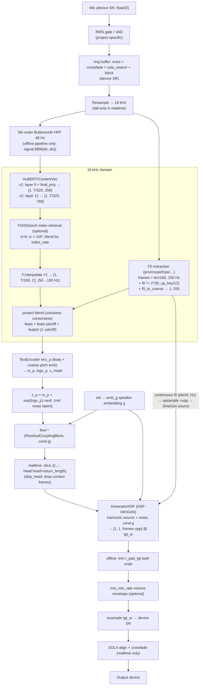

# 02 — Canonical RVC Inference Pipeline (microphone → output)

**Scope.** What actually happens to audio inside RVC inference, traced in the canonical repo (RVC-Project/Retrieval-based-Voice-Conversion-WebUI, branch `main`): offline pipeline `infer/vc/pipeline.py` (`Pipeline.vc` / `Pipeline.pipeline`), realtime core `infer/rtrvc.py` (`RVC.infer`), model code `infer/module/models.py`; cross-checked against w-okada `server/voice_changer/RVC/pipeline/Pipeline.py` and Applio `rvc/realtime/pipeline.py`. Note: upstream restructured in 2025 — the historical `infer/modules/vc/pipeline.py` is now `infer/vc/pipeline.py`; the logic is the same.

---

## 1. Sample-rate map (verified)

| Stage | Rate | Where set |
|---|---|---|
| Microphone / device | device SR (typically 44.1/48 k; rvc-webui optionally uses the **model SR** as stream rate: `sr_type="sr_model"`) | `realtime_gui.py` `GUI.start_vc` |
| HuBERT/ContentVec + F0 + index | **16 000 Hz** fixed | `Pipeline.__init__`: `self.sr = 16000  # hubert输入采样率` |
| Feature hop ("window") | **160 samples @16 k = 10 ms** → 100 frames/s at model rate | `self.window = 160` (pipeline.py L55, rtrvc.py, w-okada Pipeline L66) |
| HuBERT output frame rate | **50 Hz** (CNN front-end stride 320) → doubled to 100 Hz by `F.interpolate(scale_factor=2)` | pipeline.py L198, rtrvc.py L298 |
| Synthesizer output | **model `tgt_sr`**: 32 000 / 40 000 / 48 000 = `cpt["config"][-1]` | `get_synthesizer` (rtrvc.py L34-L53) |
| NSF upsampling | `upp = prod(upsample_rates) = tgt_sr / 100` (e.g. 40 k: 10·10·2·2=400; 48 k: 12·10·2·2=480) | `GeneratorNSF.__init__`: `self.upp = math.prod(upsample_rates)` (models.py L473) |
| Output to device | resampled `tgt_sr → device SR` (`librosa.resample` offline; `torchaudio.Resample` realtime) | pipeline.py L398-401; realtime_gui.py `resampler2` |

So one 10 ms frame at 16 k ⇔ one phone/pitch frame ⇔ `tgt_sr/100` output samples.

---

## 2. End-to-end diagram



Tensor shapes for one realtime block (example: block 160 ms, extra 2.5 s, crossfade 80 ms, sola 10 ms, model 40 k):
- 16 k buffer: ~44 160 samples → `p_len = 276` frames; HuBERT `[1, 138, 768]` → ×2 → `[1, 276, 768]`; `pitch/pitchf [1, 276]`; `skip_head = 250`, `return_length = 26`; decoder output `26·400 = 10 400` samples @40 k ≈ 260 ms (block+crossfade+search).

---

## 3. Stage-by-stage, with code

### 3.1 Pre-filter and padding (offline `Pipeline.pipeline`)
- `bh, ah = signal.butter(N=5, Wn=48, btype="high", fs=16000)`; `audio = signal.filtfilt(bh, ah, audio)` — removes DC/rumble before F0/HuBERT ([infer/vc/pipeline.py#L20, L286]). **Core-ish but optional in realtime** (none of the realtime cores apply it; mic HPF or RNNoise covers it).
- Long audio is cut at low-energy points: `t_center`/`t_query` search over a sliding abs-sum (`opt_ts` logic, L288-L301). **Offline-only machinery.**
- Each segment is reflect-padded by `t_pad = 16000 * x_pad` seconds on both sides (x_pad 1–3 s depending on VRAM, `configs/config.py#L255-L270`), and after synthesis the corresponding `t_pad_tgt = tgt_sr * x_pad` samples are cut: `self.vc(...)[self.t_pad_tgt : -self.t_pad_tgt]` (L332-L394). Purpose: give HuBERT/F0 clean context so segment edges don't click. **This is what `extra`+SOLA replaces in realtime.** w-okada keeps it available as "RVC Quality" (`repeat=1`, `Pipeline.exec` computes `quality_padding_sec` and trims `audio1[t_pad_tgt:-t_pad_tgt]`).

### 3.2 F0 extraction + coarse quantization (`Pipeline.get_f0`, `RVC.get_f0_post`)
- Methods in canonical repo today: `pm` (parselmouth), `rmvpe`, `fcpe` (harvest/dio/crepe live on in w-okada's plugins and Applio adds swift-f0/crepe).
- Unvoiced gaps are **linearly interpolated** (`np.interp` over `f0==0`) before use — the realtime cores do this too; the *coarse* path still treats f0≤threshold as bucket 1.
- Transpose: `f0 *= pow(2, f0_up_key / 12)` (semitones) — this is where our +12-ish M→F shift happens.
- **f0_to_coarse / f0_mel** ([pipeline.py#L132-L139], identical in rtrvc `get_f0_post`, w-okada `RMVPEPitchExtractor`, Applio `get_f0`):
  ```python
  f0_min, f0_max = 50, 1100
  f0_mel = 1127 * log(1 + f0/700)                      # mel scale
  f0_mel = (f0_mel - mel(50)) * 254 / (mel(1100) - mel(50)) + 1
  f0_coarse = rint(clip(f0_mel, 1, 255))               # 1..255 ints; 1 = unvoiced
  ```
  `pitch` (coarse, int64) feeds an **embedding in TextEncoder**; `pitchf` (continuous Hz, float) feeds the **NSF source** and the protect mask. Both are per-10 ms frame, length `p_len = len(audio_16k)//160`. **Core RVC requirement** — the synthesizer was trained on exactly this quantization.

### 3.3 Embedding: ContentVec/HuBERT layer taps (`infer/hubert.py`)
- v1: hidden layer **9** then `final_proj` Linear(768→256) → 256-d; v2: final encoder layer **12** output → 768-d. Verified in `extract_hubert_features` docstring/logic ([infer/hubert.py#L69-L80]) and in w-okada's detector (`embOutputLayer 9 + useFinalProj` for v1, `12 + no final_proj` for v2, `RVCModelSlotGenerator._setInfoByPytorch`). Applio: `feats = hubert(feats)["last_hidden_state"]; final_proj if v1` ([rvc/realtime/pipeline.py#L487-L493]).
- Canonical repo and Applio/Vonovox all moved from fairseq to **Transformers-ported checkpoints** (`HubertModelWithFinalProj`); w-okada still has fairseq (`FairseqHubert`) + ONNX ContentVec options.
- HuBERT front-end stride is 320 samples → output frame rate 50 Hz: `T_feats ≈ len_16k/320`.

### 3.4 Index retrieval + blending (`Pipeline.vc` L177-L196)
```python
score, ix = index.search(npy, k=8)          # faiss IVF; npy = feats[0] float32
weight = np.square(1/score); weight /= weight.sum(1, keepdims=True)
npy = (index_vectors[ix] * weight[...,None]).sum(1)
feats = torch(npy)*index_rate + (1-index_rate)*feats
```
- `index_vectors = index.reconstruct_n(0, index.ntotal)` (the trained big_npy re-materialized from the FAISS index) — same in rtrvc (`self.big_npy`) and w-okada; Applio keeps it as a GPU tensor (`big_tsr`).
- Realtime variants search only post-context frames (`feats[0][skip_head//2:]`, rtrvc L252) — context frames keep their raw embeddings. w-okada uses `k=1` for speed. Requires the **added_*.index** (trained+added), not `trained_*.index` (rtrvc prints an error if ix<0).
- **Project-specific optimization**, not a core requirement — `index_rate=0` is valid and common for a well-trained single-voice model.

### 3.5 2× feature interpolation (50→100 Hz)
- `feats = F.interpolate(feats.permute(0,2,1), scale_factor=2).permute(0,2,1)` ([pipeline.py#L198]); realtime first duplicates the last frame (`torch.cat((feats, feats[:,-1:,:]),1)`, rtrvc L248; Applio L495) so the doubled length covers `p_len`. Then `feats = feats[:, :p_len]` and pitch tensors are clipped to the same `p_len`. **Core requirement**: synthesizer and pitch run at 100 Hz.

### 3.6 Protect mechanism (voiceless consonants) — `Pipeline.vc` L175-L217
```python
if protect < 0.5 and pitch is not None:
    feats0 = feats.clone()                  # BEFORE index blending
    ... index ... interpolate both feats and feats0 ...
    pitchff = pitchf.clone()
    pitchff[pitchf > 0] = 1                 # voiced frames: keep converted feats
    pitchff[pitchf < 1] = protect           # unvoiced (f0==0): mostly original feats
    feats = feats * pitchff.unsqueeze(-1) + feats0 * (1 - pitchff)
```
- Semantics: on frames where F0 extraction found no pitch (consonants, breath), blend back toward the **pre-index** HuBERT features with weight `1-protect`; `protect=0.5` disables (the branch requires `<0.5`), `0` = maximum protection. Rationale: index retrieval drags voiceless frames toward voiced training vectors, smearing consonants ("电音"/artifact fix).
- Note a real divergence: w-okada clones `feats0` **after** interpolation and only when index search is active (`protect < 0.5 and search_index`, Pipeline.py L212-L238, see their PR #276 comment); Applio clones before index like upstream (`feats0 = feats.detach().clone() if use_f0 and protect<0.5`, L497). Upstream semantics (clone pre-index, gate on f0 only) is the canonical one. **Core-adjacent**: only meaningful when using index and/or f0.

### 3.7 Synthesizer: enc_p → rnd latent → flow⁻¹ → NSF-HiFiGAN
From `infer/module/models.py` (`SynthesizerTrnMs256/768NSFsid.infer`, `GeneratorNSF`, `SineGen`):
- `enc_p(phone, pitch_coarse, lengths)` — TextEncoder: Linear(256|768→hidden) + pitch **Embedding(256, hidden)** summed, transformer encoder → `m_p, logs_p, x_mask`.
- **Noise latent:** `z_p = m_p + torch.exp(logs_p) * torch.randn_like(m_p) * 0.66666` (the `rnd` term; some exports take rnd as an explicit input so ONNX runs are reproducible — w-okada's `SynthesizerTrnMs*_ONNX` wrappers do exactly that). Means output is stochastic frame-to-frame unless seeded/captured; CUDA-graph capture freezes one noise draw per graph (replays reuse the generator state baked at capture — acceptable in practice, both graph implementations ignore it).
- **Speaker embedding:** `g = emb_g(sid).unsqueeze(-1)`, conditions flow and decoder. `cpt["config"][-3]` is patched to `emb_g.weight.shape[0]` at load (n_spk), sid selects the speaker (0 for single-speaker models).
- `z = flow(z_p, x_mask, g=g, reverse=True)` — residual coupling flow inverse.
- **Realtime trimming:** `infer(..., skip_head, return_length, return_length2)` slices `z`, `x_mask`, `nsff0` to the last `return_length` frames before decoding, and `n_res=return_length2` lets the decoder resize output for formant resampling ([models.py#L646-L686]). Applio equivalent: `head` computed in pipeline, `net_g.infer(..., skip_head=head)`.
- **NSF source:** `SineGen._f02sine(f0, upp)` builds per-sample phase from frame F0 upsampled ×`upp`; harmonics summed → `SourceModuleHnNSF` tanh-mixes to a 1-ch excitation; `GeneratorNSF.forward` adds `noise_convs[i](har_source)` into each upsampling stage of HiFiGAN ([models.py#L267-L490]). This is why **pitchf must be continuous Hz at 100 Hz** — it literally drives the oscillator; wrong scaling = wrong pitch regardless of coarse pitch embedding.
- Non-f0 variants (`*_nono`) skip pitch entirely (TextEncoder without pitch emb, plain Generator).

### 3.8 Output post-processing
- **Offline:** trim `t_pad_tgt`; `change_rms(input_16k, output_tgt, rms_mix_rate)` — per-0.5 s RMS envelopes interpolated to sample rate, `output *= (rms1^(1-rate) · rms2^(rate-1))`; rate=1 keeps RVC's own loudness ([pipeline.py#L23-L42, L396-L397]). Then optional resample and int16 normalize with clip-guard (`audio_max/0.99`).
- **Realtime (rvc-webui):** `rms_mix_rate` applied in the audio callback over the model-rate output with 4·zc frame / zc hop envelopes ([realtime_gui.py#L868-L900]); Applio does it in-pipeline (`AudioProcessorTorch.change_rms`, `volume_envelope` param) over `return_length*160` input tail. w-okada instead multiplies output by `sqrt(vol)` of the input block (RVCr2 L245) — a cruder envelope.
- **SOLA** (realtime only): see doc 01 §2.5/§3.3/§4.2.

---

## 4. Core RVC requirements vs project-specific optimizations

| Element | Status |
|---|---|
| 16 kHz analysis domain, 160-hop frames, f0_to_coarse 1..255 (mel 50–1100 Hz), continuous pitchf → NSF | **Core — trained-in, do not change** |
| HuBERT/ContentVec tap: v1 L9+final_proj/256-d, v2 L12/768-d; 50→100 Hz ×2 interpolation (+ last-frame dup in streaming) | **Core** |
| TextEncoder + rnd latent + flow⁻¹ + NSF-HiFiGAN, speaker emb via sid; output @ `config[-1]` SR | **Core** |
| protect blend (needs pre-index feats0 + pitchf mask) | Core-adjacent (only with f0; exact clone point varies by project) |
| index retrieval & index_rate | Optional quality feature |
| Butterworth 48 Hz HPF, opt_ts segmentation, t_pad reflect padding/trim | Offline-pipeline specific |
| extra context + skip_head/return_length, pitch ring cache `[3:-1]`, silenceFront, SOLA/phase-vocoder, RMS gate/VAD, auto block size, CUDA graphs, fp16, formant resample, rms_mix in callback | Realtime project optimizations |

---

## 5. Timing budget cheat-sheet (frames & samples)

```
device SR = S, model SR = M, zc = S/100
block      = round(block_time * S / zc) * zc           # multiple of 10 ms
16k mirror = 160 * block/zc
p_len      = buffer_16k // 160                         # 100 Hz frames
hubert     = buffer_16k // 320 frames  → ×2 (+dup) → p_len
skip_head  = extra_16k // 160          (frames of context to discard)
return_len = (block + sola_buf + sola_search)/zc        (frames to vocode)
decoder out= return_len * (M/100) samples @ M
algorithmic latency ≈ block + crossfade + device_latency (+0.01 safety)  [realtime_gui.py L477-L482]
```

---

## 6. Key takeaways for our implementation

1. Respect the trained-in contract exactly: 16 k/160-hop/mel-coarse-255/continuous-Hz-pitchf/100 Hz features. Every repo that works reimplements these identical five lines of `f0_to_coarse`.
2. Build the realtime path as: persistent GPU rings (device-SR + 16 k mirror) → tail-only F0 with `[3:-1]` cache splice → full-buffer HuBERT → post-context-only index → ×2 interp → protect → `skip_head/return_length` synthesis → SOLA. That is the converged design of rvc-webui and Applio; w-okada's numpy-buffer version is the same math, slower.
3. Keep `protect` implemented upstream-style (clone **before** index, gate on `pitchf`), default 0.33–0.5; it audibly matters for M→F consonants when index_rate > 0.
4. `rms_mix_rate`: implement Applio-style in-pipeline on GPU; default 0 (keep input dynamics) for talking, expose slider.
5. The noise latent means non-deterministic output; if we CUDA-graph the synthesizer the noise freezes per capture — fine, but regenerate graphs on model reload and don't A/B quality across graph/eager without noting this.
6. Latency floor = block + crossfade + device. Everything model-side (graphs, fp16, decoder trimming) only buys a *smaller feasible block*; plan the UI metric exactly like realtime_gui's delay readout.
7. HPF/noise handling belongs before the 16 k domain (RNNoise or a one-pole HPF); skip the offline filtfilt (non-causal, adds nothing in realtime).
