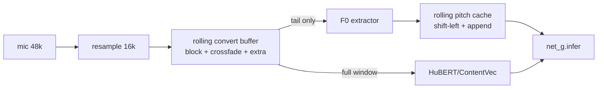

# 05 — F0 Extraction Research for Realtime RVC

Scope: deep comparison of F0 extractors for an ultra-low-latency realtime RVC voice changer
(single male speaker, male→female +4..+12 semitone transposition, Windows + NVIDIA CUDA).
All claims traced to source in the four reference repos (paths relative to `repos/`):

- `Applio` — `rvc/realtime/pipeline.py`, `rvc/realtime/core.py`, `rvc/realtime/utils/{fcpe,chunks,torch}.py`, `rvc/lib/predictors/{RMVPE,FCPE,Swift,f0}.py`
- `voice-changer` (w-okada) — `server/voice_changer/RVC/pipeline/Pipeline.py`, `server/voice_changer/RVC/pitchExtractor/*`
- `rvc-webui` (canonical RVC) — `infer/rtrvc.py` (realtime), `infer/vc/pipeline.py`, `infer/rmvpe.py`
- `Vonovox` — closed source (Cython `.pyd`); conclusions from README + binary strings, tagged accordingly.

Papers: RMVPE ([arXiv:2306.15412](https://arxiv.org/abs/2306.15412)), CREPE ([arXiv:1802.06182](https://arxiv.org/abs/1802.06182)), SwiftF0 ([arXiv:2508.18440](https://arxiv.org/abs/2508.18440)), FCPE (torchfcpe, CFNaiveMelPE; [arXiv:2404.09910 era PC-mer line]), WORLD/Harvest (Morise 2017), Dio (Morise 2009).

---

## 1. The common contract

Every extractor in every repo is run against **16 kHz mono** audio with a **160-sample hop (10 ms)**, producing one F0 value per RVC feature frame (HuBERT frames are 20 ms; RVC interpolates features 2× so pitch and features align at 10 ms). The pipeline then:

1. applies the semitone transpose `f0 *= 2**(f0_up_key/12)`,
2. mel-quantizes to 255 coarse buckets (`f0_coarse`) + keeps continuous `pitchf`,
3. feeds both into `net_g.infer`.

Unvoiced frames are encoded as `f0 == 0` → coarse bucket 1. Everything below is about how each extractor produces that 100 Hz F0 track, with how little audio, and how often.



---

## 2. Extractor-by-extractor analysis

### 2.1 RMVPE

**Architecture** (Applio `rvc/lib/predictors/RMVPE.py`, identical lineage in `rvc-webui/infer/rmvpe.py` and w-okada's `DiffusionSVC/pitchExtractor/rmvpe`):

- Input: log-mel spectrogram, `MelSpectrogram(N_MELS=128, 16000, win=1024, hop=160, fmin=30, fmax=8000)` (`RMVPE0Predictor.__init__`, line 451). `torch.stft(center=True)` → each mel frame already sees ±512 samples (±32 ms) around its center.
- `E2E` = `DeepUnet` (5 encoder / 5 decoder levels, `kernel_size=(2,2)` avg-pool, 4 ConvBlockRes per level, 4 intermediate blocks) over the (time × 128 mel) plane, then `Conv2d(16→3)` and a **bidirectional GRU** (`BiGRU(3*128, 256, 1)`) + `Linear(512, 360)` + sigmoid → 360-bin cents salience (20-cent bins starting ~C1).
- Decode: `to_local_average_cents` — argmax bin ± 4 neighbors, salience-weighted average of cents; frames whose max salience ≤ `thred` (0.03) are zeroed (unvoiced). `f0 = 10 * 2**(cents/1200)`.

**Receptive field / minimum context.** Two hard constraints in source:

1. `mel2hidden` (RMVPE.py line 462) pads the mel to a **multiple of 32 frames** (`32*((n-1)//32+1)`, reflect) because the 5-level U-net halves time 5 times (2⁵ = 32).
2. The **BiGRU is bidirectional over the whole window**: every output frame depends on *all* frames fed in, forward and backward. There is no fixed finite receptive field — the effective one is "whatever you give it". Empirically the useful context saturates; the realtime repos settle on ~0.3 s.

**How much audio does RMVPE actually need?** The realtime answer is in `rvc-webui/infer/rtrvc.py::infer` (line ~283) and Applio `rvc/realtime/pipeline.py::_voice_conversion` (line 447):

```python
f0_extractor_frame = block_frame_16k + 800
if f0method == "rmvpe":
    f0_extractor_frame = 5120 * ((f0_extractor_frame - 1) // 5120 + 1) - 160
```

i.e. block + 800 samples (5 frames of guard), rounded up to a multiple of **5120 samples (320 ms = 32 frames × 160)** minus one hop, so the mel frame count is exactly a multiple of 32 and `mel2hidden`'s reflect-pad is a no-op. For any block ≤ ~315 ms, RMVPE is run on the **last 4960 samples (310 ms)** of the rolling buffer. That is the de-facto minimum in both canonical realtime implementations. It will run on less (down to one 32-frame tile ≈ 320 ms after padding), but accuracy of the BiGRU and the U-net border frames degrades; below ~64 ms the reflect padding dominates and output is garbage.

**GPU/CPU, FP16, VRAM.** Pure PyTorch; runs on CUDA/CPU/MPS. rvc-webui constructs it with `is_half` (FP16 supported offline); Applio realtime keeps it FP32 (`vc.dtype = torch.float32`, pipeline.py line 48) and instead relies on TF32 (`precision.py::enable_experimental_tf32`, opt-in, SM ≥ 8.0) and CUDA Graphs. Weights ≈ 55 MB FP32 (~181M-param-class U-net is actually ~ 40M params); runtime VRAM for a 310 ms window is tens of MB. Per-block cost on a modern NVIDIA GPU: ~1–3 ms, but it is the *deepest* of the extractors (hundreds of kernel launches — exactly why Applio captures it inside the per-block CUDA graph, pipeline.py `_graph_supported` / `voice_conversion`).

**Realtime adaptations in Applio** (`pipeline.py::setup_f0`, f0_method == "rmvpe"): it monkey-patches `infer_from_audio` and `to_local_average_cents` into **pure-tensor variants** (no `.cpu().numpy()`, no host sync), moves `cents_mapping` to the device, and disables the offline "high-register corrector" (`high_register={"enabled": False}`) because that corrector (`rvc/lib/predictors/f0.py::RMVPE._fix_high_register`) is a two-pass numpy/librosa method (second RMVPE pass on 2× resampled audio to fix octave errors above ~1040 Hz) — irrelevant for speech, far too slow for realtime.

**Low-male-voice accuracy.** RMVPE was trained on vocal corpora with bins down to ~32.7 Hz region (360 × 20-cent bins from 1997.38 cents ≈ 32 Hz); it is the most robust of the pack on creaky/low male phonation and in noise (its U-net sees the whole harmonic stack in the mel). The salience threshold 0.03 gives permissive voicing — good continuity, occasional voiced leakage on breath. For male→female the *extractor* only needs to be right at 70–160 Hz; the ×2^(k/12) transpose happens downstream, so extractor ceiling is irrelevant. This is why Vonovox's README says "RMVPE models for best results".

### 2.2 FCPE

**Architecture** (Applio `rvc/lib/predictors/FCPE.py`, same torchfcpe lineage used by w-okada `FcpePitchExtractor` via `torchfcpe.spawn_bundled_infer_model`):

- `Wav2Mel`: STFT mel, `n_fft=1024, win=1024, hop=160` at 16 kHz (bundled model config), **center=False with manual (win−hop)/2 reflect padding** (`STFT.get_mel`, lines 133-141) → each frame sees ±~432 samples (±27 ms).
- `FCPE(nn.Module)` (line 570): conv-in stack `Conv1d(128→512,k=3)+GN+LeakyReLU+Conv1d(512→512,k=3)`, then **PCmer**: `n_layers=12` conformer-ish blocks, `dim_model=512`, each = `ConformerConvModule` (depthwise conv, kernel 31) + **linear-attention `SelfAttention(causal=False)`** (Performer-style softmax-kernel attention), then `LayerNorm + Linear(512→360)` → 360-bin cents salience, same decode family as RMVPE (`cents_local_decoder`: argmax ± 4 bins).
- Despite "lightweight" branding vs CREPE-full, FCPE is a 12-layer 512-dim transformer; it is light because linear attention makes it **O(n)** in frames and the mel front-end is cheap. Params ≈ 36 MB fp32.

**Context.** Non-causal attention + kernel-31 depthwise conv over the whole window: like RMVPE, every frame can attend to everything, so "receptive field" = window length. The only *hard* minimum is one STFT frame (1024 samples), but quality needs real context. The empirical number is pinned in Applio `pipeline.py::_voice_conversion` lines 449-453:

```python
elif self.f0_method == "fcpe":
    # Chunk duration should control latency, not pitch quality.
    # Keep the default 250ms block's 300ms analysis history even
    # when streaming much smaller blocks; no lookahead is added.
    f0_frame = max(f0_frame, 4800)
```

→ **FCPE is always fed ≥ 4800 samples (300 ms)** regardless of block size; no mel-tile rounding needed (no U-net). rvc-webui's realtime path feeds it `block + 800` with no floor — i.e. the canonical GUI gives FCPE as little as ~130 ms on small blocks, which is exactly the regime where Applio found quality loss and added the 300 ms floor. Decoder threshold 0.006 (both repos), stricter voicing than RMVPE's 0.03.

**Realtime adaptations in Applio** (`rvc/realtime/utils/fcpe.py`): `RealtimeMel` replaces `Wav2Mel.mel_extractor` with a fixed-shape, no-host-sync STFT (precomputed Hann buffer, no min/max diagnostic checks), and `local_decoder` re-implements the 9-bin local-argmax decode with **all index math on-device** — both purely to remove GPU↔CPU syncs so FCPE can live inside the CUDA graph (`setup_f0`, lines 267-280; `strip_parametrizations` removes weight-norm so capture is legal).

**GPU/CPU/FP16.** PyTorch; CUDA/CPU/MPS (MPS needs the CPU mel fallback, `f0.py::FCPE.__init__`). FP32 in Applio realtime. Cheapest per-block of the two neural trackers (~0.5–1.5 ms GPU for 300 ms). Good but slightly below RMVPE on noisy/creaky low male voice; voicing decisions are crisper (fewer octave errors in clean speech, slightly more dropouts on breathy onsets).

### 2.3 CREPE / torchcrepe

**Architecture** (paper + torchcrepe usage in Applio `pipeline.py::get_f0` f0_method "crepe", `f0.py::CREPE`, w-okada `CrepePitchExtractor`): operates on raw **1024-sample windows at 16 kHz per frame** (hop 160), 6-layer strided CNN → 360-bin cents classification. `model="full"` ≈ 22M params; `"tiny"` ≈ 0.5M.

- Per-frame receptive field is **exactly 1024 samples (64 ms)** — fully frame-local, no cross-frame model state. This makes CREPE the only neural tracker that is *trivially* incrementally computable: compute only the new frames, keep old ones.
- But the implementations don't exploit that: `torchcrepe.predict` re-frames and re-runs the whole supplied window every block, and both Applio and w-okada then apply **median/mean filters of width 3** over frames and a periodicity gate (`pd < 0.1 → f0 = 0`), which needs ±1 frame context (cheap).
- Cost: 1024-sample window per 160-hop frame → 6.4× redundant input coverage; "full" is the most expensive option per frame of all extractors (w-okada uses `batch_size=256`, Applio 512, to amortize). Decoding via `weighted_argmax` (w-okada) or default.
- Not CUDA-graph-eligible in Applio (`voice_conversion` line 627: graphs only for `("fcpe","rmvpe")`), and on MPS it is pushed to CPU.
- Accuracy: strong on clean speech; noticeably more octave errors on noisy/low male voice than RMVPE (no long-range context to disambiguate harmonics); periodicity threshold tuning is fiddly.

### 2.4 SWIFT (SwiftF0) — Applio only (+ Vonovox binary)

**Implementation** (`Applio/rvc/lib/predictors/Swift.py`): ONNX model (`swift.onnx`, ~95k params per the [SwiftF0 paper](https://arxiv.org/abs/2508.18440)) run via onnxruntime, CPU provider by default, CUDA EP if available. Constants at top of file:

```python
SAMPLE_RATE = 16000; HOP = 256; FMIN = 46.875; FMAX = 2093.75
LOOKAHEAD_FRAMES = 10; LEFT_FRAMES = 11; WINDOW_FRAMES = 1875
```

- Native hop is **256 samples (16 ms)**, not 160 — `SWIFT.get_f0 → infer_from_audio` runs the model on its own grid, then **interpolates the contour onto the 10 ms RVC timeline** (`target_timestamps = arange(p_len) * hop_size/sr`, Swift.py line ~274). It processes long audio in 1875-frame sliding windows with 11 left / 10 lookahead guard frames.
- Confidence gating: frames whose raw hop peak < 1e-3 are forced unvoiced (line 127-128); threshold `filter_radius=0.5` in `pipeline.py::get_f0`.
- Realtime status: selectable in Applio's realtime pipeline (`setup_f0` accepts "swift"), **but** `get_f0` converts through numpy (`torch.from_numpy(f0)...`, pipeline.py line 325) → host round-trip → excluded from CUDA graphs. It is attractive as a **CPU** extractor (sub-ms per block for small windows; the paper reports ~0.09 s for 10 s audio on CPU), freeing the GPU entirely.
- Accuracy: paper claims CREPE-comparable on speech down to low SNR with 42× less compute; fmin 46.9 Hz covers low male voices. Less field-proven inside RVC than RMVPE/FCPE; the 16 ms→10 ms resampling of the contour slightly smears rapid pitch movement. Vonovox ships a `swiftf0` module too (binary `core/inference/swiftf0/swift_f0.pyd`), so at least one latency-focused product considers it viable.

### 2.5 Harvest / Dio / pm (classical)

- **Harvest** (w-okada `HarvestPitchExtractor`): `pyworld.harvest(frame_period=10)` + `stonemask` refine + `medfilt(3)`. CPU-only, ~O(100 ms) for a 1 s window — *the* latency killer; w-okada keeps it for CPU-only users and quality-offline parity. Excellent voicing/accuracy on clean speech, degrades in noise less gracefully than RMVPE. No incremental mode in pyworld.
- **Dio** (w-okada `DioPitchExtractor`): `pyworld.dio(channels_in_octave=2) + stonemask`. ~5-10× faster than Harvest, visibly worse accuracy (octave errors on low/creaky voice). CPU only.
- **pm (Praat ac)** (`rvc-webui/infer/rtrvc.py::get_f0`, method "pm"): parselmouth `to_pitch_ac(time_step=0.01, voicing_threshold=0.6, floor=65)`, with explicit `1.5/f0_min*16000 ≈ 369` sample pads each side. Very fast CPU, but f0_floor 65 Hz clips deep male voices and voicing is brittle; kept in rvc-webui's realtime GUI mostly as the zero-dependency fallback.
- All three return numpy, require CPU transfer of the window, and gate unvoiced via their own detectors; they cannot participate in a GPU-resident pipeline.

### 2.6 Newer alternatives (not in these repos)

- **torchcrepe "tiny" + streaming decode** — viable but strictly dominated by SwiftF0 on cost/accuracy.
- **PENN / FCN-F0** (frame-local CNNs like CREPE) — EXPERIMENTAL, same incremental-friendly property as CREPE, no RVC-ecosystem integration.
- **RMVPE-ONNX** (w-okada `RMVPEOnnxPitchExtractor`) — same model via onnxruntime; useful if V1 goes ONNX/TensorRT end-to-end.

---

## 3. CRITICAL: how streaming pitch history is maintained

### 3.1 Applio realtime (the mechanism to copy)

Buffers (`rvc/realtime/core.py::Realtime.realloc`):

- `convert_buffer`: `block + sola_search + extra + crossfade` samples @16 k, rounded up to a 160 multiple. Default `extra_convert_size = 0.5 s`, block configurable (worker default 24576 @48 k = 512 ms; `utils/chunks.py::automatic_block_frame` picks `ceil(processing_ms*1.5)` clamped to [100 ms, 1000 ms]).
- `pitch_buffer` (int64) and `pitchf_buffer` (float): length `convert_feature_size_16k + 1` — **one slot per 10 ms frame of the whole conversion window, plus 1** ("+1 compensates for pitch extraction algorithm that can output an additional feature").

Every block (`core.py::Realtime.inference` → `pipeline.py::_voice_conversion`):

1. New 16 k audio is `circular_write`-appended to `convert_buffer` (shift-left by block, append; `utils/torch.py::circular_write`). On silence the buffers are **zeroed**, not frozen ("stale speech must not be replayed", core.py line 337).
2. F0 is extracted **only from the tail**: `audio[-f0_frame:]` where `f0_frame = block_size_16k + 800`, rounded for RMVPE (multiple of 5120 − 160) or floored for FCPE (≥ 4800). So the extractor recomputes the last ~0.3 s, never the whole 1+ s window.
3. The pitch caches are rolled: `shift = block_size_16k // 160`; `pitch[:-shift] = pitch[shift:].clone()` (same for pitchf) — frames older than the current block are **reused verbatim, never recomputed**.
4. From the freshly computed tail, the **boundary frames are discarded**: `interior = f0_new[3:-1]` ("Trim unreliable boundary frames before writing to cache", `get_f0` lines 396-401 / `_voice_conversion` lines 474-479) — the first 3 and last 1 frames of each extraction are polluted by window padding, so only the interior overwrites the tail of the cache. Because `f0_frame > block + 800`, the interior still covers (and slightly re-covers) the new block's frames; the few frames of overlap are simply overwritten by the newer, better-contextualized estimate.
5. `pitch[-p_len:]` / `pitchf[-p_len:]` (the whole window's worth) go to `net_g.infer`, so the synthesizer always sees a full-window pitch contour assembled from cached history + fresh tail.

**Answer: yes, F0 history is cached instead of recalculated.** Only ~310 ms (RMVPE) / ~300 ms (FCPE) of audio is re-analyzed per block, regardless of a 0.5–2.5 s context window; everything older rides in the rolling `pitch/pitchf` ring. Evidence: Applio `pipeline.py::_voice_conversion` lines 440-479 and `core.py` buffer allocation; the identical ancestral pattern in `rvc-webui/infer/rtrvc.py::infer` (lines ~281-293: `cache_pitch[:-shift] = cache_pitch[shift:].clone(); cache_pitch[4 - pitch.shape[0]:] = pitch[3:-1]`). Applio is a direct refinement of the RVC-Project realtime GUI code.

### 3.2 w-okada voice-changer

`RVC/pipeline/Pipeline.py::exec` receives the **whole padded window every chunk** and calls `self.pitchExtractor.extract(audio_pad, ..., silence_front=...)`. Each extractor (RMVPE/FCPE/crepe/harvest/dio) then:

- skips `silence_front` seconds at the head (frames known to be silent context) — a coarse optimization, frame-aligned via `start_frame = int(silence_front*sr/window)`;
- **recomputes F0 for the entire remaining window** (typically extra + block ≈ 1–3+ s), then splices into the caller-provided `pitchf` ring: `pitchf[-f0.shape[0]:] = f0[:pitchf.shape[0]]`.

So w-okada keeps a pitchf buffer across chunks but only as a length aligner — the model still runs over the full window each block. This is the main reason w-okada's "EXTRA" setting directly inflates per-chunk latency (see doc 07 §A.3 for the same effect on HuBERT). No `[3:-1]` interior trimming; boundary frames land in the output every block.

### 3.3 Vonovox

Closed source. Binary strings show `get_f0_rmvpe`, `torchfcpe`, `swift_f0` modules and per-stage timing strings (`"ms | Index: "`, `t_index_start`), and the README documents a "Lookahead buffer" (recommended 2.0) whose "added latency ... is far less impactful than the block size" — consistent with the rvc-webui/Applio design: large context window, tail-only F0 recompute, GPU-resident pipeline ("Nearly every operation is processed on the GPU"). LIKELY it uses the same rolling-cache pattern; cannot be confirmed from source.

---

## 4. Male→female suitability notes

- The transpose is applied *after* extraction (`f0 *= 2**(k/12)`), so what matters is accuracy at the **source** register, 70–180 Hz. RMVPE (fmin ≈ 32 Hz-class bins, mel fmin 30 Hz) and FCPE (f0_min 32.7 Hz) both cover it; SwiftF0 bottoms at 46.9 Hz (fine for all but extreme fry); Praat-pm's 65 Hz floor in rtrvc clips deep voices — avoid.
- Octave errors are catastrophic here: a halved male F0 (e.g. 55 Hz read as 110) then shifted +12 st lands in a plausible female range and produces audible register flips mid-word. RMVPE's long-context BiGRU is the most octave-stable; CREPE the least (frame-local).
- Voiced/unvoiced quality: thresholds in the repos — RMVPE 0.03 (permissive), FCPE 0.006 on its own confidence (crisp), CREPE periodicity 0.1 + median filter, SwiftF0 0.5 + silence peak gate. For m→f, false-voiced on breath is worse than false-unvoiced (breath gets pitched into a whine); FCPE's gating behaves best in practice, RMVPE benefits from the input noise gate / VAD that all three apps put in front (Applio `utils/vad.py` Silero-class VAD + RMS gate; Vonovox RNNoise + Silero).
- Applio extras worth copying: `proposed_pitch` (pipeline.py `get_f0` lines 349-379) auto-computes the semitone offset from the running median F0 vs a target (default 155 Hz) — ideal "auto m→f" UX; `autotune_f0` snaps to nearest note (cheap, graph-safe).

---

## 5. Decision table

| Extractor | Added latency need (context) | Per-block GPU cost | Quality (low male voice, noise) | V/UV quality | Complexity / integration | Incremental-friendly | Recommendation |
|---|---|---|---|---|---|---|---|
| **RMVPE** | 310 ms tail recompute (5120-sample tiles) | ~1–3 ms GPU, kernel-heavy (wants CUDA graph) | **Best**: octave-stable, noise-robust | Good (0.03 thr, permissive) | Medium (tensorize decode, strip offline corrector) | Via rolling cache only (BiGRU = full-window model) | **V1 default** |
| **FCPE** | 300 ms tail recompute (Applio floor) | ~0.5–1.5 ms GPU, O(n) attention | Very good; slightly weaker on creak/noise | Very good (crisp) | Medium (RealtimeMel + local_decoder patches) | Via rolling cache only | **V1 second option / low-GPU** |
| **SwiftF0** | ≥ ~21 frames guard (11 left + 10 lookahead ≈ 0.34 s @256 hop) | ~0 GPU (**CPU** ONNX, sub-ms) | Good (paper-claimed CREPE-class); 16 ms native grid resampled to 10 ms | Good (conf. gate) | Low (ONNX session) but numpy round-trip, no CUDA graph | Frame-windowed → genuinely streamable | **V1 third option** for CPU offload / weak GPUs (EXPERIMENTAL within RVC) |
| CREPE full | 64 ms/frame window, filters ±1 frame | Highest (22M params × every frame) | Good clean / weak noisy; octave-flippy | OK w/ periodicity gate | Low (torchcrepe) | Yes in principle, not in torchcrepe API | Skip (dominated) |
| CREPE tiny | same | low | mediocre | mediocre | low | yes | Skip (SwiftF0 better) |
| Harvest | whole window, CPU | 0 GPU but ~100 ms+ CPU | very good clean | very good | trivial | no | Offline only — never realtime |
| Dio | whole window, CPU | ~10–20 ms CPU | weak on low voice | ok | trivial | no | Skip |
| pm (Praat ac) | ~37 ms pads | ~ms CPU | poor < 65 Hz | brittle | trivial | no | Skip |

**V1 should ship: RMVPE (default), FCPE (alt / lower GPU load), SwiftF0 (CPU-side experimental).** Rationale: RMVPE+FCPE are what every reference realtime pipeline converged on (Applio restricts CUDA-graph capture to exactly these two; Vonovox ships exactly "FCPE or RMVPE" per its README; rvc-webui realtime offers rmvpe/fcpe/pm) and virtually all public RVC models were trained on RMVPE labels. SwiftF0 is the one genuinely new option with a real engineering payoff (zero GPU contention, true streaming) at modest risk.

---

## 6. Direct answers

- **How much historical audio does RMVPE actually need?** Hard floor: one 32-mel-frame tile ≈ 320 ms (its U-net downsamples time ×32; `mel2hidden` pads to multiples of 32 frames). Practice in both canonical realtime codebases: `block + 800` samples rounded up to `5120·n − 160` → **4960 samples (310 ms) for any block ≤ ~310 ms** (`rvc-webui/infer/rtrvc.py` line ~285; `Applio/rvc/realtime/pipeline.py` line 448). The BiGRU means more context monotonically (slightly) helps, but 310 ms is the proven sweet spot.
- **How much does FCPE need?** Hard floor: 1 STFT frame (1024 samples). Quality floor per Applio's measured comment: **4800 samples (300 ms)** (`pipeline.py` lines 449-453 — "Chunk duration should control latency, not pitch quality"). rvc-webui feeds it less on small blocks; Applio's floor is the better engineering.
- **Can F0 history be cached instead of recalculated?** **Yes — PROVEN.** Both rvc-webui realtime (`cache_pitch`/`cache_pitchf` shift-and-append with `pitch[3:-1]` interior trimming) and Applio (`pitch_buffer`/`pitchf_buffer` + `circular_write`, identical `[3:-1]` trim) recompute only a ~300 ms tail per block and reuse everything older. What **cannot** be cached is *internal model state* for RMVPE/FCPE (bidirectional GRU / non-causal attention over the given window) — hence the fixed tail-window recompute rather than true streaming. SwiftF0's sliding-window design (11 left / 10 lookahead guard frames) is the only one amenable to true incremental framing — EXPERIMENTAL.

---

## 7. Key takeaways for our implementation

1. **Copy the Applio/rtrvc rolling pitch cache verbatim**: int64 coarse + float fine ring buffers sized to the full conversion window + 1; shift by `block/160`; write only `f0[3:-1]`; extract from `audio[-(block+800):]` with the RMVPE 5120-tile rounding and the FCPE 4800-sample floor. (PROVEN, two independent codebases.)
2. **Decouple F0 context from block size.** Tiny blocks (←latency) must not shrink the analysis window (←pitch quality). The 300 ms tail costs the same every block regardless of block length — at 50 ms blocks F0 becomes ~6× redundant work, which is still only ~1-3 ms GPU; accept it for V1, consider SwiftF0-on-CPU if GPU budget is tight.
3. **Keep the whole F0 path on-device and sync-free** so it can sit inside a per-block CUDA graph: tensorized `to_local_average_cents` (RMVPE), `RealtimeMel` + `local_decoder` (FCPE), weight-norm stripped, `cents_mapping` as a device buffer. Applio's `setup_f0` is a ready-made recipe. (PROVEN in Applio; graphs opt-in behind env flags because capture failures require process restart — replicate that supervisor pattern.)
4. **Zero (don't freeze) pitch/convert buffers across silence gates** to avoid replaying stale speech (Applio core.py line 337, 348-354).
5. For m→f, implement Applio's `proposed_pitch` median-F0 auto-offset (target ~155-185 Hz) and expose autotune strength; prefer FCPE's stricter voicing or add a VAD/noise gate ahead of RMVPE.
6. Do **not** support Harvest/Dio/pm in the realtime path; offer them (plus RMVPE's high-register two-pass corrector) only if we ever add offline file conversion.
