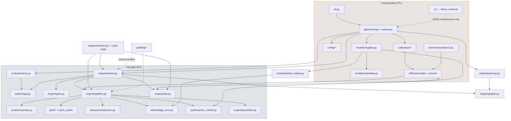

# 12 — Project Structure

Status: design complete · The repository layout and module contracts to begin development from.
Synthesizes docs 01–11; every structural decision below traces to a finding in those documents.
Target: a focused local desktop app — one Python process, Windows + NVIDIA CUDA, no services, no
Docker, no database (doc 11 guiding rule: "boring, pinned, single-process").

---

## 1. Architecture principles enforced by this layout

These are the 18 rules the structure must make easy to follow and hard to violate. Each cites its
research grounding.

| # | Principle | Source |
|---|---|---|
| P1 | Audio callbacks do memcpy + metering only (~µs); never block, allocate, lock, or touch CUDA | doc 03 §9 (rvc-webui inline-callback glitching is the anti-pattern) |
| P2 | No model/file loading, no imports, no config parsing in realtime threads — all loading happens in control-path code before `engine.start()` | doc 03 §9, doc 06 §5 (warmup) |
| P3 | Zero steady-state allocation in the hot path: preallocated GPU rings, `circular_write`, reused scalar tensors | doc 06 §2.3 (Applio `realloc`, `_p_len_tensor`) |
| P4 | One interface per F0 extractor; RMVPE/FCPE/SwiftF0 are plugins behind `PitchExtractor` | doc 05 §5 |
| P5 | One interface per synthesis backend; torch-eager is the V1 implementation, ONNX decoder is a stub behind the same seam | doc 06 §7 (Applio `infer_latent`/`run_decoder` split) |
| P6 | The index is optional: `index_rate=0` must cost nothing and never load vectors | doc 07 §B.6 |
| P7 | Post-processing (RMS mix, formant post-shift, FX) is a modular chain; anything CPU-bound is excluded from graph capture | doc 06 §10, doc 08 §2.7 |
| P8 | Profiling is built in, always compiled, toggleable — CUDA events + perf_counter + counters | doc 04 §5, doc 10 |
| P9 | The UI owns no inference state; it edits profiles and sends commands over a thin control surface | doc 11 §8 (w-okada split, done locally) |
| P10 | Hot-reconfigurable params (pitch, index_rate, protect, rms_mix) apply between hops without restart; shape-changing params (block, extra, model) trigger a controlled stop→realloc→recapture | doc 06 §2.4 (graph cache keys) |
| P11 | Voice profile, model config, device config, and runtime (GPU) config are separate files with separate consumers | doc 08 §5 |
| P12 | The backend is headless; `vox run` works with no GUI installed | doc 11 §8 |
| P13 | Offline (wav→wav) and realtime use the **identical engine** — the offline harness is a feeder, not a second pipeline | doc 10 §1 |
| P14 | Module boundaries are native-swap friendly: audio I/O, rings, and worker have numpy-in/numpy-out (or tensor-in/tensor-out) interfaces so any one can later become a Rust/C++ extension | doc 03 §9 |
| P15 | Buffers are designed graph-first: pointer-stable, fixed shape, allocated once; graph capture failure is a restart-class event | doc 06 §2.4 |
| P16 | Untrusted inputs (checkpoints, indexes) load with `weights_only=True` and are validated by weight-sniffing, never by trusting dict keys | doc 09 §1, §5 |
| P17 | The chunking law is owned by exactly one module (`engine/chunker.py`): `convert = extra + crossfade + sola_search + block`, padded to 160-sample multiples @16 k, with `skip_head`/`return_length` derived there and nowhere else | doc 03 §1 |
| P18 | No over-abstraction: one concrete class per interface until a second implementation exists; interfaces are Python `Protocol`s, not ABC hierarchies | pragmatism |

---

## 2. Repository layout

```
rvc-vox/
├── pyproject.toml                # project metadata, entry point `vox = vox.cli:main`
├── requirements/                 # lock-driven pins (doc 11 §9)
│   ├── runtime.txt               # torch 2.7.x+cu128, sounddevice, faiss-cpu, torchfcpe, silero-vad…
│   ├── tools.txt                 # faster-whisper, resemblyzer, parselmouth, matplotlib
│   └── dev.txt                   # pytest, ruff, py-spy
├── src/vox/
│   ├── __init__.py
│   ├── cli.py                    # `vox run|convert|calibrate|bench|models|devices`
│   ├── audio/                    # device I/O + transport (CPU, hot path edges)
│   │   ├── devices.py
│   │   ├── streams.py
│   │   ├── rings.py
│   │   └── resample.py
│   ├── pitch/                    # F0 extractors (GPU)
│   │   ├── base.py
│   │   ├── rmvpe.py
│   │   ├── fcpe.py
│   │   ├── swift.py
│   │   └── pitch_cache.py
│   ├── features/                 # content embedder (GPU)
│   │   ├── base.py
│   │   └── contentvec.py
│   ├── retrieval/                # optional index (GPU)
│   │   ├── gpu_knn.py
│   │   └── index_loader.py
│   ├── synthesis/                # RVC synthesizer (GPU)
│   │   ├── rvc_model.py
│   │   ├── nsf_decoder.py        # interface seam (decoder backends)
│   │   └── onnx_backend.py       # stub, V1.x
│   ├── engine/                   # orchestration — the heart
│   │   ├── pipeline.py
│   │   ├── chunker.py
│   │   ├── sola.py
│   │   ├── gate.py               # VAD + RMS gate + silence state machine
│   │   ├── worker.py
│   │   ├── graphs.py             # CUDA graph capture/replay/invalidate
│   │   ├── warmup.py
│   │   └── postchain.py          # rms_mix, optional formant post-shift, FX hooks
│   ├── models/                   # model management (control path)
│   │   ├── discovery.py
│   │   ├── metadata.py
│   │   └── registry.py
│   ├── calibration/              # one-time voice measurement (control path)
│   │   ├── session.py
│   │   ├── analysis.py
│   │   └── tuning.py
│   ├── profiling/                # built-in profiler (P8)
│   │   ├── timers.py
│   │   ├── stats.py
│   │   └── report.py
│   ├── config/                   # profile schemas + load/save
│   │   ├── schemas.py
│   │   ├── store.py
│   │   └── defaults.py
│   ├── offline/                  # wav-in → wav-out harness, SAME engine (P13)
│   │   ├── simulate.py
│   │   └── convert.py
│   └── api/                      # thin control surface for future UI (P9, P12)
│       ├── control.py
│       └── events.py
├── ui/                           # EMPTY placeholder (README only); never imported by src/vox
├── models/                       # user model storage (doc 09 §6 layout)
│   ├── <ModelName>/{model.pth, model.index, config.json}
│   ├── _embedders/contentvec/…
│   └── _predictors/{rmvpe.pt, fcpe.pt, swift_f0.onnx}
├── profiles/                     # per-user JSON profiles (doc 08 §5)
│   └── default/{voice_profile,calibration,audio_device,runtime,model_overrides}.json
├── tests/
│   ├── unit/                     # chunker math, sola, rings, metadata sniffing, schemas
│   ├── engine/                   # offline-engine golden tests (small fixture wavs)
│   └── fixtures/
├── benchmarks/
│   ├── bench.py                  # `vox bench` implementation (doc 10)
│   ├── sweeps/*.yaml
│   ├── corpus/                   # user corpus (gitignored), manifest committed
│   ├── baselines/
│   └── results/
├── scripts/
│   ├── fetch_assets.py           # download contentvec/rmvpe/fcpe weights with hashes
│   └── setup_env.ps1             # venv + cu128 wheel install on Windows
└── docs/
    └── research/                 # these documents
```

Notes on the top level:

- `ui/` is an empty directory with a README stating the contract: UIs talk to `vox.api` only
  (JSON commands/events over stdio or localhost WS), import nothing from `vox.engine` (P9, P12).
- `models/` and `profiles/` are data directories, not packages; `vox.models.registry` and
  `vox.config.store` are their only readers/writers.
- Dependency rule, enforced by convention + an import-linter config in `pyproject.toml`:
  **nothing in `vox/` imports from `ui/`; `engine/` imports the stage packages, never vice versa;
  stage packages (`pitch/`, `features/`, `retrieval/`, `synthesis/`) import only torch + `config`
  + `profiling`; `audio/` imports only numpy/sounddevice.**

---

## 3. Module-by-module contracts

Legend: **RT** = runs on the realtime hot path (per-hop or per-callback); **CTL** = control path
(startup, reconfigure, UI commands). CPU/GPU = where its steady-state work executes.

### 3.1 `vox/audio/` — device I/O and transport (P1, P14)

#### `audio/devices.py` — CTL, CPU
- **Responsibility:** enumerate/select devices via sounddevice per host API; validate sample rates;
  fingerprint devices for `audio_device.json`; detect VB-Cable/VAC presence and warn if the cable
  isn't pinned at 48 kHz (doc 03 §8).
- **Key API:** `list_devices() -> list[DeviceInfo]`, `resolve(profile.audio_device) -> (in_dev, out_dev, monitor)`,
  `check_cable_rate(dev) -> Warning|None`.
- **Imports:** `sounddevice`, `vox.config.schemas`. **Imported by:** `streams.py`, `cli.py`, `api/control.py`.
- **State:** none (pure queries).

#### `audio/streams.py` — RT (callbacks) + CTL (open/close), CPU
- **Responsibility:** own the `sd.InputStream` (mic) and `sd.OutputStream` (cable) — separate
  streams because mic and cable are distinct clock domains (doc 03 §8); optional monitor
  OutputStream. Callbacks do exactly: memcpy into/out of rings, peak/RMS meter accumulation,
  increment `status`-flag counters (`input_overflow`, `output_underflow` — the references ignore
  these; we must not, doc 04 §5.2), and signal the worker semaphore when ≥1 hop of new input exists.
- **Key classes:** `DuplexAudio` — `start(cfg: DeviceConfig, in_ring, out_ring, hop_event)`,
  `stop()`, `health() -> StreamHealth`. WASAPI shared default, `latency="low"`,
  `WasapiSettings(exclusive=True)` behind a flag, `AsioSettings` opportunistic (doc 03 §8).
- **Imports:** `sounddevice`, `numpy`, `vox.audio.rings`, `vox.profiling.timers` (counter handles only).
  **Imported by:** `engine/worker.py` (lifecycle), `api/control.py`.
- **State owned:** the two (three) PortAudio streams; callback-side meter accumulators.
- **Hot-path budget:** callback body < 100 µs; no Python allocation beyond slice views.

#### `audio/rings.py` — RT, CPU
- **Responsibility:** the SPSC ring buffers crossing the callback↔worker boundary (doc 03 §10).
  `InputRing` (mono f32 @48 k, ~4 s capacity): callback writes, worker reads a sliding window.
  `OutputRing` (f32 @48 k, 2–4 hops capacity, explicit fill target = measurable `T_output_buffer`):
  worker writes exactly one hop, callback reads blocksize; underrun → emit zeros + count;
  overrun → drop oldest + count.
- **Key classes:** `SPSCRing(capacity)` with `write(np.ndarray)`, `read_latest(n) -> view`,
  `fill() -> int`; indices are plain Python ints updated single-writer/single-reader (GIL-atomic);
  numpy backing array, power-of-two capacity. Designed so a later native (Rust) swap changes only
  this file (P14).
- **Imports:** numpy only. **Imported by:** `streams.py`, `engine/worker.py`, `offline/simulate.py`.
- **State owned:** the two ring arrays + indices + underrun/overrun counters.

#### `audio/resample.py` — RT, GPU
- **Responsibility:** the exactly-two fixed-rate GPU resamplers (doc 03 §6): 48 k→16 k incremental
  with the rvc-webui overlap-and-discard trick (resample new block + 2·zc overlap, drop first 160
  output samples), and tgt_sr→48 k for output. Both `torchaudio.transforms.Resample` modules,
  device-resident, static shapes, graph-capturable. Also `soxr`-based offline file resampling for
  calibration/bench (CPU, control path).
- **Key API:** `IncrementalResampler16k.push(block_48k_gpu) -> fresh_16k_gpu`,
  `OutputResampler(tgt_sr).run(audio_gpu) -> audio_48k_gpu`, `file_resample(path, sr)` (CTL).
- **Imports:** torch, torchaudio, soxr. **Imported by:** `engine/pipeline.py`, `calibration/`.
- **State owned:** resampler kernels; the 2·zc overlap stash tensor.

### 3.2 `vox/pitch/` — F0 extraction (P4)

#### `pitch/base.py` — CTL (definition), GPU
- **Responsibility:** the `PitchExtractor` Protocol every extractor implements:
  ```python
  class PitchExtractor(Protocol):
      name: str
      graph_safe: bool              # may live inside the CUDA graph (rmvpe/fcpe yes, swift no)
      def tail_samples(self, block_16k: int) -> int: ...   # how much tail audio it needs
      def extract(self, audio_16k_tail: Tensor) -> Tensor: ...  # f0 Hz @100 Hz frames, 0=unvoiced
      def load(self, device, assets_dir) -> None: ...       # CTL only
  ```
  Plus shared post-processing: `f0_to_coarse` (mel 50–1100 → 1..255, the trained-in contract,
  doc 02 §3.2), transpose `f0 *= 2**(up_key/12)`, median filter, and calibrated clamps
  `f0_min/f0_max` from `voice_profile.json` (doc 08 §2.4).
- **Imports:** torch. **Imported by:** rmvpe/fcpe/swift, `engine/pipeline.py`.

#### `pitch/rmvpe.py` — RT, GPU · **V1 default**
- Vendored RMVPE (ecosystem norm, doc 11 §4) with Applio's realtime adaptations: tensor-native
  `to_local_average_cents`, device-resident `cents_mapping`, no high-register corrector (doc 05 §2.1).
- `tail_samples(block)` = `5120 * ((block + 800 - 1)//5120 + 1) - 160` — the 32-mel-frame tile
  rounding; ≈ 4960 samples (310 ms) for blocks ≤ ~310 ms (doc 05 §6). FP32 always (doc 06 §5).
- **State owned:** model weights, mel frontend buffers.

#### `pitch/fcpe.py` — RT, GPU · **V1 alternate**
- torchfcpe bundled model with `RealtimeMel` fixed-shape STFT + on-device `local_decoder`
  (doc 05 §2.2). `tail_samples(block)` = `max(block + 800, 4800)` — the 300 ms Applio floor.

#### `pitch/swift.py` — RT, **CPU** (onnxruntime) · experimental option
- SwiftF0 ONNX on CPU; 256-hop native grid interpolated to the 10 ms timeline; `graph_safe=False`
  → selecting it disables whole-pipeline graph capture for the F0 stage (pipeline splits the graph
  or falls back eager, doc 05 §2.4).

#### `pitch/pitch_cache.py` — RT, GPU
- **Responsibility:** the rolling pitch cache (doc 05 §3.1, PROVEN in two codebases): `pitch`
  (int64 coarse) + `pitchf` (float Hz) rings of length `convert_frames + 1`; per hop: shift left by
  `block_16k // 160`, write fresh extractor output trimmed `[3:-1]` (boundary frames unreliable);
  `zero()` on gate-close (stale speech must not be replayed).
- **Key API:** `roll_and_write(f0_fresh)`, `views() -> (pitch, pitchf)` (stable pointers for graph
  capture, P15), `zero()`.
- **Imported by:** `engine/pipeline.py`, `engine/gate.py` (zeroing).
- **State owned:** the two cache tensors.

### 3.3 `vox/features/` — content embedder

#### `features/base.py` — CTL, GPU
- `Embedder` Protocol: `load(device, assets_dir)`, `embed(audio_16k_window: Tensor) -> Tensor`
  (50 Hz frames, 256/768-d per model version), `dim: int`. Shared helper: last-frame duplication +
  `F.interpolate(scale_factor=2)` to 100 Hz lives in `engine/pipeline.py`, not here (it is pipeline
  math, doc 02 §3.5).

#### `features/contentvec.py` — RT, GPU · V1 only implementation
- HF-Transformers `HubertModelWithFinalProj` (doc 02 §3.3): v1 = `final_proj(hidden_states[9])`
  → 256-d; v2 = layer-12 output → 768-d. Runs over the **full conversion window every hop** — no
  KV cache possible (bidirectional attention, doc 07 §A.4). FP16 autocast around the embedder only,
  output cast back to FP32 (doc 06 §5, behind `runtime.json` flag). SPIN/other HuBERT variants are
  later weight swaps through the same class.
- **Imports:** torch, transformers. **Imported by:** `engine/pipeline.py`, `calibration/` (reuses
  the embedder? no — calibration only needs F0/RMS; embedder stays engine-only).
- **State owned:** model weights (~95M params).

### 3.4 `vox/retrieval/` — optional index (P6)

#### `retrieval/index_loader.py` — CTL, CPU→GPU
- **Responsibility:** read `.index` with faiss-cpu (`read_index` + `reconstruct_n` — the only
  legitimate faiss use, doc 06 §9), validate `index.d == emb_dim`, reject `trained_*` indexes,
  cap/subsample > ~200 k vectors, upload as a contiguous GPU tensor with precomputed `‖b‖²`.
  Lazy: nothing loads until `index_rate > 0`; unload frees VRAM and **invalidates CUDA graphs**
  (doc 07 key takeaway 6).
- **Key API:** `load(path, emb_dim, device) -> GpuIndex`, `unload()`.
- **State owned:** the GPU vector matrix + norms.

#### `retrieval/gpu_knn.py` — RT, GPU
- **Responsibility:** brute-force squared-L2 via `addmm` + `topk(k=8)` + inverse-square-distance
  weighted blend, over `feats[skip_head//2:]` only (canonical math, doc 07 §B.2); graph-capturable;
  CPU-FAISS fallback path on VRAM OOM.
- **Key API:** `blend(feats, gpu_index, index_rate, skip_offset) -> feats`.
- **Imported by:** `engine/pipeline.py`.

### 3.5 `vox/synthesis/` — the RVC model (P5)

#### `synthesis/rvc_model.py` — CTL (load) + RT (infer), GPU
- **Responsibility:** construct `SynthesizerTrnMs256/768NSFsid[_nono]` from checkpoint config;
  loading invariants (doc 09 §1): `weights_only=True`, patch `config[-3]` from `emb_g.weight`,
  `tgt_sr = config[-1]`, delete `enc_q`, strip weight norm. Exposes
  `infer(feats, p_len, pitch, pitchf, sid, skip_head, return_length) -> audio_tgt_sr` — tail-only
  decoding (doc 02 §3.7). Owns vendored model code (`models.py` port: TextEncoder, flow, NSF).
- **Imports:** torch, `vox.models.metadata` (for detection results). **Imported by:**
  `engine/pipeline.py`, `models/registry.py`.
- **State owned:** `net_g` weights; speaker-id tensor (constant 0 for single-speaker).
- **Precision:** FP32 + TF32; decoder FP16 behind a flag; NSF SineGen cumsum always FP32 (doc 06 §5).

#### `synthesis/nsf_decoder.py` — interface seam, GPU
- `DecoderBackend` Protocol: `decode(latent, source, speaker) -> audio`. V1 implementation is
  simply "the decoder stage inside rvc_model" (`TorchDecoder`); the file exists so the Applio-style
  split (`infer_latent` → external decoder) has a named seam (P5).

#### `synthesis/onnx_backend.py` — stub, V1.x
- Empty `OnnxDecoder(DecoderBackend)` raising `NotImplementedError`, with a docstring pointing to
  Applio `onnx_decoder.py` as the template (IO binding, ORT CUDA graphs, SHA-256 export cache,
  excitation stays in torch). Exists only to pin the interface (doc 06 §7/§12).

### 3.6 `vox/engine/` — the orchestrator

#### `engine/chunker.py` — CTL (sizing) — the single owner of the chunking law (P17)
- **Responsibility:** given `(block_ms, crossfade_ms, extra_ms, sola_search_ms, device_sr, model_sr)`
  compute every derived size, all rounded to `zc = sr//100` units:
  ```
  convert_16k    = block_16k + crossfade_16k + sola_search_16k + extra_16k, padded to %160 == 0
  skip_head      = extra_16k // 160                       # context frames to drop
  return_length  = convert_frames - skip_head             # frames to vocode (block+overlap+search)
  sola_buffer    = min(crossfade, 4*zc)                   # ≤40 ms
  decoder_out    = return_length * model_sr // 100
  ```
  Returns a frozen `ChunkPlan` dataclass consumed by pipeline, pitch_cache, sola, graphs, and the
  profiler's latency estimate (`hop + overlap + search + ring_fill + stream.latency`). Pure math,
  no torch — fully unit-testable.
- **Imported by:** everything in `engine/`, `offline/simulate.py`, `benchmarks/bench.py`.

#### `engine/pipeline.py` — RT, GPU · the per-hop conversion
- **Responsibility:** one function, `process_hop()`, executing the converged reference design
  (docs 02/03/05/06/07):
  1. incremental resample 48 k→16 k into the GPU 16 k mirror ring,
  2. tail-only F0 via the active `PitchExtractor` → `pitch_cache.roll_and_write`,
  3. embedder over the full 16 k window, last-frame dup + ×2 interpolate, v1 final_proj,
  4. optional `gpu_knn.blend` (skip_offset = skip_head//2),
  5. protect blend upstream-style (clone **before** index, gate on `pitchf`, doc 02 §3.6),
  6. `rvc_model.infer(..., skip_head, return_length)` — tail-only decode,
  7. output resample tgt→48 k, `postchain.run`,
  returning a GPU tensor of `block + overlap + search` samples for SOLA.
- All buffers come preallocated from `chunker.ChunkPlan` at `realloc()`; the whole function is the
  capture target for `graphs.py` (steps 1–7, excluding anything `graph_safe=False`).
- **Imports:** `audio.resample`, `pitch.*`, `features.*`, `retrieval.*`, `synthesis.*`,
  `engine.postchain`, `profiling.timers`. **Imported by:** `engine/worker.py`, `offline/simulate.py`.
- **State owned:** GPU rings (`input_16k`, feature scratch), `_p_len_tensor`-style reused scalars.

#### `engine/sola.py` — RT, GPU
- **Responsibility:** SOLA stitching exactly per doc 03 §4: conv1d NCC numerator /
  `sqrt(conv1d(x², ones)+ε)` denominator over a 10 ms search window, offset kept **on-device**
  (`index_select` with tensor offset — no `.item()`), sin²/cos² equal-power crossfade over
  20–40 ms; saves the new tail as `sola_buffer`. Optional phase-vocoder crossfade behind a flag
  (A/B item, doc 01 §7). Supports gate protocol hooks: `drain_tail()` (fade overlap out exactly
  once), `zero()` + onset fade-in on voice resume (Applio protocol, doc 03 §5).
- **State owned:** `sola_buffer`, fade windows, `_tail_remaining` drain state.
- **Imported by:** `engine/worker.py` (after pipeline output), `offline/simulate.py`.

#### `engine/gate.py` — RT, CPU (decision) + GPU (buffer zeroing)
- **Responsibility:** the silence/VAD state machine — the four-buffer coherence problem
  (doc 03 §5): RMS threshold from `calibration.json` (noise_floor + margin), Silero VAD with
  configurable hangover/release (~200–400 ms), sustained-voice rescue optional. On
  silent: skip the GPU pipeline, command `pitch_cache.zero()` + context-buffer zero, trigger
  `sola.drain_tail()`; keep advancing the input ring. On resume: `sola.zero()` + onset fade.
- **Key API:** `decide(block_48k) -> GateDecision(speech: bool, onset: bool, drain: bool)`.
- **State owned:** VAD model, hangover timer, gate state enum.
- One deliberate scalar sync per hop (`vol.item()`) is accepted here — the irreducible set (doc 06 §2.7).

#### `engine/worker.py` — RT (its own daemon thread), CPU orchestrating GPU
- **Responsibility:** the inference worker loop decoupling ≤10 ms callbacks from the 20–32 ms hop
  (doc 03 §10): wait on the hop semaphore → slice window from `InputRing` → `gate.decide` →
  `pipeline.process_hop` (graph replay) → `sola.stitch` → single `.cpu()` copy of exactly one hop
  into `OutputRing` → profiler stage stamps. Thread, not process (torch releases the GIL; Applio's
  process split is the escape hatch if p99 shows GIL stalls, doc 03 §9). Applies hot-reconfig
  param updates (P10) between hops from an atomic "pending config" slot.
- **Key classes:** `InferenceWorker(plan, pipeline, sola, gate, rings, profiler)` —
  `start()/stop()`, `apply_params(RuntimeParams)` (lock-free swap), `stats()`.
- **Imports:** everything in `engine/` + `audio/rings`. **Imported by:** `api/control.py`,
  `offline/simulate.py` (bypassed — simulate drives pipeline+sola directly with the same objects).
- **State owned:** the thread, pending-params slot, hop counter.

#### `engine/graphs.py` — CTL (capture) + RT (replay), GPU
- **Responsibility:** whole-pipeline CUDA graph capture per the Applio pattern (doc 06 §2.4):
  3 eager warmup iterations on a side stream, snapshot/restore of mutable cache state around
  warmup, capture of `pipeline.process_hop` body; cache keyed on buffer `data_ptr()`s + ChunkPlan +
  model identity + precision flags; invalidation hooks for index load/unload and param shape
  changes; eager fallback; `GraphCaptureError` → supervisor restart policy. Second, separate graph
  for the SOLA/output stage. `detect_support()` probe at startup (rvc-webui pattern).
- **Imported by:** `engine/worker.py`, `engine/warmup.py`.
- **State owned:** captured `torch.cuda.CUDAGraph` objects + static I/O tensors.

#### `engine/warmup.py` — CTL, GPU
- **Responsibility:** service-level warmup before going live (doc 06 §12 #5): set TF32/precision
  flags once, run ≥5 full silent hops at the production ChunkPlan with gating disabled (covers
  cuDNN, allocator, both graph captures, resamplers, SOLA), zero all buffers after, report
  `max(timings[-3:])` as steady-state estimate — which also feeds the auto hop sizing
  (Applio `automatic_block_frame` generalized: initial hop = clamp(1.5 × measured, bounds)).
- **Imported by:** `api/control.py` (start sequence), `benchmarks/bench.py`.

#### `engine/postchain.py` — RT, GPU (P7)
- **Responsibility:** ordered, individually-toggleable post stages: GPU `change_rms`
  (volume_envelope, Applio-style in-pipeline), optional formant post-shift (≤1.08, default off,
  doc 08 §2.7), future FX hooks. Each stage declares `graph_safe`; a CPU stage splits the capture
  region. V1 ships rms_mix only.
- **State owned:** RMS envelope scratch tensors.

### 3.7 `vox/models/` — model management (all CTL, CPU)

#### `models/metadata.py`
- **Responsibility:** the drag-and-drop detection algorithm from doc 09 §5 verbatim:
  `weights_only=True` load, sr from `config[-1]` cross-checked against `prod(upsample_rates)*100`,
  f0 sniffed from `dec.m_source.*` keys, version from `enc_p.emb_phone.weight.shape[1]`
  (256→v1/768→v2, authoritative over the dict key), n_spk from `emb_g.weight`, embedder/vocoder
  fields, index pairing (prefer `added_*`, verify dim). Surfaces the validation errors list
  (training checkpoint, trained_* index, dim mismatch, fork config).
- **Imported by:** `discovery.py`, `registry.py`, `cli.py`.

#### `models/discovery.py`
- Scan `models/` dir, import new `.pth`+`.index` drops (rename into `<Name>/model.pth`, write
  detected `config.json` per doc 09 §6), download/verify shared embedder + predictor assets.

#### `models/registry.py`
- **Responsibility:** the in-memory model registry: `get(name) -> LoadedModel` (constructs
  `synthesis.rvc_model` + pairs the index path + merges per-model defaults from `config.json` and
  `model_overrides.json` per the resolution order of doc 08 §7). Model switch = controlled engine
  stop→load→realloc→recapture→start, never on the hot path (P2).
- **State owned:** loaded model handle(s); only one resident in V1.

### 3.8 `vox/calibration/` — CTL, CPU (+GPU for RMVPE)

- `session.py`: the guided 4-pass recording flow (silence / read / dynamics / edge material,
  doc 08 §4.1) through the exact production input chain, NR/VAD off; writes raw WAVs into
  `benchmarks/corpus/` (they double as the quality corpus, doc 10 §4).
- `analysis.py`: F0 distribution **using the shipped RMVPE** (not Praat), RMS distribution, noise
  floor, clipping check, voiced ratio, per-extractor octave-flip rate → writes
  `voice_profile.json` + `calibration.json`; computes
  `f0_up_key = round(12*log2(F0_model_median / F0_user_median))` per target model (doc 08 §2.3).
- `tuning.py`: the staged offline search (pitch sweep first, then index/protect) driving
  `offline/simulate.py`, scoring with F0-stat gates + WER gate + speaker-cosine ranking, exporting
  top-3 candidates for the mandatory human A/B (doc 08 §6); writes `model_overrides.json`.
- **Imports:** `offline.simulate`, `pitch.*`, tools extras (faster-whisper, resemblyzer — import
  guarded, only in the tools venv). **Imported by:** `cli.py`.

### 3.9 `vox/profiling/` — RT (stamps) + CTL (aggregation) (P8)

- `timers.py`: `StageTimers` — `time.perf_counter_ns` boundaries (scheduling truth) + CUDA event
  pairs per stage read **one hop later / on 1 Hz flush**, never a sync inline (doc 04 §5.1); inside
  a captured graph only whole-graph events (stage-wise profiling happens in eager warmup). Counter
  handles for underruns/overflows/dropped hops/VAD transitions/SOLA-offset histogram.
- `stats.py`: fixed 1024-hop ring of per-stage float32 samples; p50/p95/p99/max computed off the
  hot path at 1–2 Hz; headroom gauge `hop/p99` feeding the auto-tuner hysteresis (raise hop < 1.2×,
  consider lowering > 2×); ring-fill gauge = measured `T_output_buffer`; end-to-end estimate.
- `report.py`: the rt-profiler text table (doc 04 §5.3 format) + JSONL event log; NVML sampling
  thread (10 Hz) for bench runs.
- **Imported by:** everything RT (handles are preallocated at start; stamping is append-only).

### 3.10 `vox/config/` — CTL, CPU (P11)

- `schemas.py`: dataclass/TypedDict schemas for the five profile files (doc 08 §5:
  `voice_profile`, `calibration`, `audio_device`, `runtime`, `model_overrides`) + per-model
  `config.json` + `RuntimeParams` (the hot-reconfigurable subset: f0_up_key, index_rate, protect,
  volume_envelope, f0_method, gate thresholds) vs `ShapeParams` (block/crossfade/extra/sola —
  restart-class). The split *is* principle P10 made explicit in types.
- `store.py`: JSON load/save with `schema` versioning and atomic writes (machine-written files,
  doc 11 §5).
- `defaults.py`: engine hardcoded defaults (the left end of the doc 08 §7 resolution chain):
  block 20 ms hop / crossfade 32 ms / sola_search 10 ms / extra 500 ms / rmvpe / index_rate 0 /
  protect 0.33 / volume_envelope 1.0 / FP32+TF32 + HuBERT FP16 autocast.

### 3.11 `vox/offline/` — CTL driving the RT code (P13)

- `simulate.py`: the stream simulator (doc 10 §2): chunker-driven WAV feeder with **throughput
  mode** (back-to-back) and **realtime emulation mode** (paced, deadline-checked, underrun counting,
  optional synthetic jitter). Instantiates the *same* `pipeline`, `sola`, `gate`, `pitch_cache`,
  `graphs` objects as the live worker — it replaces only `audio/streams` + `audio/rings` with a
  file feeder and an accumulator.
- `convert.py`: user-facing `vox convert in.wav out.wav --profile …` built on `simulate` in
  throughput mode — the Phase-0/1 deliverable and the tuning loop's engine.
- **Imports:** `engine/*`, `soundfile`, `audio.resample(file path)`. **Imported by:**
  `calibration/tuning.py`, `benchmarks/bench.py`, `cli.py`.

### 3.12 `vox/api/` — CTL (P9, P12)

- `control.py`: the headless control surface: a small command set (`start`, `stop`, `set_params`,
  `switch_model`, `get_stats`, `list_devices`, `calibrate`, `shutdown`) as plain Python methods on
  `EngineController`, exposed over JSON-lines stdio and/or a localhost websocket (decide at GUI
  time). Owns the start sequence: load profile → registry.get(model) → chunker plan → realloc →
  warmup → graphs capture → streams start. Also the graph-capture-failure supervisor (restart
  policy, doc 06 §2.4).
- `events.py`: outbound event stream (stats snapshots at 1–2 Hz, underrun alerts, gate state,
  device changes) — the only data a UI ever sees.
- **Imports:** `engine/*`, `models/registry`, `config/*`, `audio/*`. **Imported by:** `cli.py`, future `ui/`.

---

## 4. Dependency-direction diagram



Arrows point from importer to imported. Invariants: nothing in `hot` imports from `control`
(the worker receives already-constructed objects); `ui/` never appears inside `src/vox`; `chunker`
and `rings` have zero torch/sounddevice dependencies respectively, keeping them trivially testable
and native-swappable (P14).

---

## 5. Data flow for one audio hop

With defaults: callback block 10 ms, hop 20 ms, crossfade 32 ms, search 10 ms, extra 500 ms,
model 48 k.

```mermaid
sequenceDiagram
    participant CB_IN as InputStream callback (CPU, ≤100µs)
    participant RING_IN as InputRing (CPU)
    participant W as InferenceWorker thread
    participant G as gate.py (CPU+1 sync)
    participant P as pipeline.py (GPU, graph replay)
    participant S as sola.py (GPU)
    participant RING_OUT as OutputRing (CPU)
    participant CB_OUT as OutputStream callback

    CB_IN->>RING_IN: memcpy 10ms block, meter, count status flags
    CB_IN->>W: semaphore when ≥1 hop (20ms) new samples
    W->>RING_IN: slice window view (extra+crossfade+search+hop @48k)
    W->>G: decide(block) — RMS vs calibrated floor, Silero VAD, hangover
    alt speech
        G->>P: proceed (upload fresh hop to GPU — the ONE upload)
        P->>P: incr. resample 48k→16k (overlap-discard) → 16k mirror ring
        P->>P: F0 tail (~310ms) → pitch_cache roll + write[3:-1]
        P->>P: ContentVec full window → dup + ×2 interp (→100Hz)
        P->>P: [optional] gpu_knn k=8 blend past skip_head//2 → protect blend
        P->>P: net_g.infer(skip_head, return_length) → tail-only decode
        P->>P: resample tgt→48k, postchain (rms_mix)
        P->>S: hop+overlap+search samples @48k (GPU)
        S->>S: NCC argmax (on-device offset), sin² crossfade vs sola_buffer, save tail
        S->>RING_OUT: ONE .cpu() copy of exactly hop samples
    else silent
        G->>P: skip GPU; zero pitch_cache + context buffers
        G->>S: drain_tail() once (fade out), then zeros
        S->>RING_OUT: faded tail / zeros
    end
    CB_OUT->>RING_OUT: read blocksize (10ms); underrun → zeros+count
    CB_OUT->>CB_OUT: write to VB-Cable device
```

Latency accounting per doc 04 §3.5: hop accumulation (20) + overlap+search (42→30) + output-ring
fill target (~1 hop + jitter) + device/cable terms → ~175 ms conservative / ~110 ms aggressive /
75–90 ms stretch; compute must satisfy `p99 < hop`.

---

## 6. Threading & process model

| Thread | Owns | Priority | Rules |
|---|---|---|---|
| PortAudio input callback | writes InputRing | native RT (PortAudio) | P1: memcpy + counters only |
| PortAudio output callback | reads OutputRing | native RT | same; zeros on underrun, never blocks |
| InferenceWorker (daemon) | GPU pipeline, SOLA, gate | normal (torch releases GIL) | the only thread touching CUDA post-start |
| Control thread (main) | api/control, config, stats aggregation | normal | never touches rings/CUDA while running except via `apply_params` slot |
| NVML/stats flush | profiler aggregation at 1–2 Hz | low | reads ring of samples, never writes hot state |

Single process in V1; `worker.py`'s interface is queue-shaped so Applio-style process isolation is
a contained change if p99 GIL stalls appear (doc 03 §9).

---

## 7. Startup sequence (control path, exact order)

1. `cli.py run --profile default` → `api.control.EngineController`.
2. Load the five profile JSONs (`config.store`), resolve device pair (`audio.devices`), warn on
   unpinned cable rate.
3. `models.registry.get(default_model)` — metadata detection, checkpoint load
   (`weights_only=True`), weight-norm strip, optional index pairing (not loaded unless rate>0).
4. `engine.chunker.plan(...)` from `runtime.json` (or auto-sizing bounds).
5. Construct pipeline/sola/gate/pitch_cache with preallocated buffers from the plan (P3/P15).
6. Set precision flags once (TF32, cudnn.benchmark=False) — before any capture (doc 06 §5).
7. `engine.warmup.run(5 silent hops)` → measured steady-state → optionally adjust hop within plan
   bounds (re-plan + re-alloc if changed).
8. `engine.graphs.capture()` (pipeline graph + SOLA graph); failure → eager fallback or restart.
9. Zero all buffers; `audio.streams.start()`; worker loop live.

---

## 8. Testing strategy baked into the structure

| Layer | Test type | Why the structure allows it |
|---|---|---|
| `engine/chunker.py` | pure unit tests of the sizing law (incl. %160 padding, zc rounding) | no torch deps |
| `audio/rings.py` | unit + two-thread stress test | numpy only |
| `engine/sola.py` | unit: known-offset sine stitching; golden crossfade output | tensor-in/tensor-out |
| `models/metadata.py` | unit with synthetic checkpoints (dict fixtures) | pure CPU |
| whole engine | `offline/convert.py` golden WAV tests (log-mel L1 vs committed baseline) | P13: offline = realtime engine |
| perf regression | `benchmarks/bench.py` gates (doc 10 §7) | profiler is built-in |

---

## Key takeaways

1. The repo is one package (`src/vox`) with a hot path (`audio`, `pitch`, `features`, `retrieval`,
   `synthesis`, `engine`, `profiling` stamps) and a control path (`models`, `calibration`,
   `config`, `offline`, `api`, `cli`); the import rules between them are the architecture.
2. `engine/chunker.py` is the single owner of the universal chunking law; `engine/pipeline.py` is
   the single per-hop function and the CUDA-graph capture target; `audio/rings.py` is the only
   cross-thread transport. Three files carry all the hard real-time invariants.
3. Offline conversion, calibration tuning, and benchmarking all drive the identical engine objects
   through `offline/simulate.py` — there is structurally no second pipeline to diverge.
4. Interfaces exist exactly where the research found proven alternatives: `PitchExtractor`
   (rmvpe/fcpe/swift), `Embedder` (contentvec/spin), `DecoderBackend` (torch/onnx stub),
   gate/postchain stages. Everything else is one concrete class (P18).
