# 13 — Implementation Roadmap

Status: plan complete · Phases reference the layout in doc 12; every acceptance criterion is
benchmarkable with the doc 10 harness. The original draft order
(0 offline → 1 pth+WAV → 2 mic→out → 3 ring+SOLA → 4 profiler → 5 calibration → 6 index →
7 CUDA opt → 8 GUI → 9 packaging) is revised per research findings:

- **Profiler moves to Phase 0/1** — doc 04/10: p99-vs-hop gates everything; building without
  measurement means tuning blind later. The profiler is ~2 files and must exist before any
  latency claim.
- **SOLA + chunker move before live audio** — the chunking law and stitching are pure math,
  testable offline (doc 12 §8); getting them right in `offline/convert.py` is far cheaper than
  debugging them under a live callback.
- **VAD/gating lands when streaming works** (not earlier) — the four-buffer silence state machine
  (doc 03 §5) only makes sense against real rings and SOLA state.
- **CUDA graphs come after correctness** (doc 06: capture freezes behavior; debugging inside a
  graph is miserable) but **before** aggressive hop shrinking, because graphs are what make small
  hops feasible.
- **Calibration before index** — doc 08: pitch offset and gate thresholds dominate perceived
  quality; the index is optional (default off, doc 07).

```mermaid
flowchart LR
    P0[0 Skeleton+profiler core] --> P1[1 Offline pth→WAV]
    P1 --> P2[2 Chunked offline engine<br/>chunker+SOLA+pitch cache]
    P2 --> P3[3 Live audio<br/>rings+worker+streams]
    P3 --> P4[4 Gate/VAD state machine]
    P4 --> P5[5 Calibration + voice profile]
    P5 --> P6[6 CUDA graphs + hop shrink]
    P6 --> P7[7 GPU index + tuning loop]
    P7 --> P8[8 Control API + GUI]
    P8 --> P9[9 Packaging]
```

---

## Phase 0 — Skeleton, environment, profiler core (≈1 week)

- **Goal:** pinned env boots on the target Windows/CUDA box; repo skeleton per doc 12; profiler
  primitives exist; assets fetchable.
- **Files:** `pyproject.toml`, `requirements/*`, `scripts/setup_env.ps1`, `scripts/fetch_assets.py`,
  `vox/config/{schemas,store,defaults}.py`, `vox/profiling/{timers,stats,report}.py`,
  `tests/unit/test_schemas.py`.
- **Acceptance:** `python -c "import torch; assert torch.cuda.is_available()"` on Python 3.12 +
  torch 2.7.x/cu128; `vox --help` runs; profiler unit test shows CUDA-event + perf_counter stage
  timing on a dummy matmul loop with p50/p95/p99 output.
- **Benchmark requirement:** record the environment fingerprint (GPU, driver, CUDA, torch) that
  doc 10 §7 requires in every result.
- **Risks:** cu128 wheel availability vs the user's driver; numpy 1.x/2.x dependency solve
  (doc 11 §4) — resolve and freeze now.

## Phase 1 — Offline conversion: .pth + WAV → WAV (≈1–2 weeks)

- **Goal:** canonical full-file RVC inference through our own code (no realtime math yet):
  load model, ContentVec, RMVPE, synthesize. Establishes the trained-in contract (doc 02).
- **Files:** `models/{metadata,discovery,registry}.py`, `synthesis/{rvc_model,nsf_decoder}.py`,
  `features/{base,contentvec}.py`, `pitch/{base,rmvpe}.py`, `offline/convert.py` (simple whole-file
  mode), `audio/resample.py` (file path), `tests/unit/test_metadata.py`.
- **Acceptance:** a known v2 48 k model converts a test WAV; output audibly matches rvc-webui
  offline output for the same settings (log-mel L1 within tolerance); metadata detection passes
  fixtures for v1/v2/f0/no-f0/missing-key checkpoints; loading uses `weights_only=True`.
- **Benchmark:** RTF of full-file conversion recorded (throughput-mode baseline).
- **Risks:** vendored models.py port drift vs upstream; checkpoint zoo weirdness (doc 09 §5
  validation errors must surface, not crash).

## Phase 2 — Chunked streaming engine, offline-fed (≈2 weeks) — the core phase

- **Goal:** the real per-hop pipeline (chunking law, rolling buffers, F0 tail recompute + pitch
  cache, tail-only decode, SOLA) running against WAV files via the stream simulator. This is the
  product's engine; everything after is transport and polish.
- **Files:** `engine/{chunker,pipeline,sola,postchain}.py`, `pitch/pitch_cache.py`, `pitch/fcpe.py`,
  `offline/simulate.py` (throughput + paced modes), `benchmarks/bench.py` (first sweep),
  `tests/unit/test_chunker.py`, `tests/unit/test_sola.py`, `tests/engine/test_golden.py`.
- **Acceptance:** chunked output of the corpus clips is free of block-boundary clicks (chunk-
  consistency metric vs Phase-1 full-file render, doc 10 §6); chunker unit tests cover %160
  padding, skip_head/return_length derivation; SOLA recovers known offsets on synthetic sines;
  pitch cache `[3:-1]` splice verified against full-window F0.
- **Benchmark:** first perf sweep (block 10–50 ms × extra 100–500 ms × rmvpe/fcpe, throughput
  mode) with per-stage p50/p95/p99 — establishes the compute budget table for the target GPU.
- **Risks:** off-by-one frame drift between 48 k and 16 k domains (the zc alignment, doc 03 §2.1);
  boundary-frame quality of HuBERT at small extra values (open question Q3, doc 14).

## Phase 3 — Live audio: rings, worker, streams (≈1–2 weeks)

- **Goal:** mic → engine → VB-Cable in real time; callbacks decoupled from the hop (the one
  genuinely novel piece vs the references, doc 03 §10).
- **Files:** `audio/{devices,streams,rings}.py`, `engine/worker.py`, `engine/warmup.py` (eager
  warmup, no graphs yet), `api/control.py` (minimal start/stop), `cli.py run`.
- **Acceptance:** 10-minute live session at a conservative hop (≥32 ms) with **zero underruns**
  (profiler counters, which must be wired to `status` flags); live latency estimate reported
  (hop+overlap+search+ring fill+stream.latency); output ring fill tracks its target; kill/restart
  is clean.
- **Benchmark:** paced realtime-emulation run matches live underrun behavior within noise —
  validates that the simulator predicts the live engine (P13 integrity check).
- **Risks:** WASAPI device quirks, VB-Cable rate SRC if not pinned at 48 kHz; GIL jitter at p99
  (escape hatch: process worker); callback discipline regressions (lint: no torch imports in
  `audio/streams.py` hot functions).

## Phase 4 — Silence gate / VAD state machine (≈1 week)

- **Goal:** Applio-grade gating: skip GPU while silent, drain SOLA tail once, zero stale buffers,
  onset fade-in, calibLess default thresholds (calibrated ones come in Phase 5).
- **Files:** `engine/gate.py`, silero-vad asset in `scripts/fetch_assets.py`, gate hooks in
  `sola.py`/`pitch_cache.py` (`drain_tail`, `zero`).
- **Acceptance:** record enter/exit silence 100× — no clicks (spectral transient check at gate
  transitions), no stale-speech replay; GPU utilization near idle during silence; word endings not
  clipped with 300–400 ms release.
- **Benchmark:** `silence_room` corpus clip shows ~0 GPU cost/hop; gated vs ungated latency
  identical during speech.
- **Risks:** four-buffer state coherence (doc 03 §5 — the documented hazard); VAD false negatives
  on sustained vowels (adopt Applio's periodicity rescue if observed).

## Phase 5 — Calibration + voice profile + M→F constants (≈1–2 weeks)

- **Goal:** the single-user payoff: measured `f0_up_key`, F0 clamps, gain/VAD thresholds, extractor
  choice by octave-flip rate; profiles consumed by the engine instead of sliders.
- **Files:** `calibration/{session,analysis}.py`, profile write-back into
  `profiles/default/*.json`, corpus capture into `benchmarks/corpus/` (doc 10 §4 clip list),
  `cli.py calibrate`.
- **Acceptance:** 45 s guided flow produces all five profile files; computed shift within ±1 st of
  the by-ear winner; calibrated F0 clamps reduce measured octave-flip rate vs 50–1100 Hz defaults
  on the fry clip; engine starts from profile with zero interactive settings.
- **Benchmark:** quality-corpus baseline run stored (F0 stats, WER, speaker-cos) — the regression
  reference for all later phases.
- **Risks:** target-model median F0 estimation (fallback 200 Hz, doc 08 §2.3); calibration UX
  without a GUI (console-guided is fine for V1).

## Phase 6 — CUDA graphs + precision + hop shrink (≈2 weeks)

- **Goal:** capture the whole pipeline + the SOLA stage as graphs (Applio pattern), apply the
  precision ladder (TF32 + HuBERT FP16 autocast), then shrink hop/overlap toward the aggressive
  budget using measured p99.
- **Files:** `engine/graphs.py`, warmup capture integration, precision flags in
  `config/defaults.py` + `runtime.json`, auto-hop logic in `warmup.py`/`stats.py`.
- **Acceptance:** graph-vs-eager outputs match (log-mel L1 < ε, noting the frozen noise draw,
  doc 02 §3.7); capture-failure path exercises eager fallback + supervisor restart; p99 compute
  drops materially vs eager at the same plan; 10-minute soak at the new hop with zero underruns.
- **Benchmark:** the headline number — end-to-end latency estimate at the smallest stable hop;
  target ≤ ~110 ms aggressive budget (doc 04 §3.5); regression gates (doc 10 §7) now armed on
  every change.
- **Risks:** capture poisoning on failure (restart policy mandatory); index/NR/CPU stages breaking
  capture (structure already isolates them); fp16 decoder artifacts (keep flagged off by default).

## Phase 7 — GPU index + automatic tuning loop (≈1–2 weeks)

- **Goal:** optional retrieval (gpu_knn + lazy loader + graph invalidation) and the offline
  tuning sweep that writes `model_overrides.json`.
- **Files:** `retrieval/{index_loader,gpu_knn}.py`, graph-invalidation hooks, `calibration/tuning.py`,
  `benchmarks/sweeps/quality_grid.yaml`.
- **Acceptance:** index on/off toggles without restart artifacts (graph recapture is clean);
  k=8 blend matches canonical numpy math on fixtures; index auto-benchmark at model load reports
  cost + VRAM delta and auto-disables over budget (doc 07 §B.6); tuning loop emits top-3 candidates
  with A/B render WAVs.
- **Benchmark:** per-hop cost delta with index on (must keep p99 < hop); quality sweep table
  (pitch × index_rate × protect) stored per doc 10 §5.2.
- **Risks:** large indexes vs VRAM (cap/subsample at load); tuning objective validity (open
  question Q10 — human A/B remains the arbiter).

## Phase 8 — Control API hardening + first GUI (≈2 weeks, parallelizable)

- **Goal:** the headless engine is complete; expose the full command/event surface and build a
  minimal UI (device picker, model picker, big latency/health readout, hot params) that owns no
  inference state.
- **Files:** `api/{control,events}.py` finalized (JSON-lines stdio + localhost WS), `ui/` first
  implementation (candidate per doc 11 §8 — decide then), `cli.py devices|models`.
- **Acceptance:** every UI action maps to one API command; engine runs identically with UI killed;
  hot params (pitch, index_rate, protect, rms_mix) apply within one hop; shape params trigger the
  controlled stop→realloc→recapture→start under 2 s.
- **Benchmark:** UI attached vs headless shows no p99 regression (GIL contention check).
- **Risks:** UI event loop stealing the GIL (mitigate: UI as separate process over the WS — the
  split is already in the structure).

## Phase 9 — Packaging + field hardening (≈1–2 weeks)

- **Goal:** portable embedded-Python folder distribution (doc 11 §7), VB-Cable setup docs/detector,
  crash/restart supervision, log bundle for support.
- **Files:** `scripts/build_portable.ps1`, first-run checks in `api/control.py` (cable pinned at
  48 k, driver version, VRAM), docs.
- **Acceptance:** clean Windows machine → unzip → `start.bat` → calibrate → live voice in < 15 min
  with no Python knowledge; regression suite green on the packaged build.
- **Benchmark:** packaged-build bench run matches dev-venv baselines (same torch, same numbers).
- **Risks:** multi-GB distribution size (expected; the reference apps accept it); driver-version
  variance across user machines (fingerprint + refuse-with-message on unsupported).

---

## Deferred (post-V1, in research priority order)

1. ONNX decoder backend (`synthesis/onnx_backend.py`) — only if decoder dominates the profile (doc 06 §7).
2. Phase-vocoder crossfade A/B → default decision (open question Q7).
3. Conv-frontend feature caching experiment (doc 07 §A.4 — EXPERIMENTAL, ~10–20% embedder cut).
4. Process-isolated worker if p99 GIL stalls observed.
5. Native ring/IO swap, TensorRT HuBERT, custom virtual device — all rejected-for-V1 items with
   named seams in doc 12.

## Key takeaways

1. Phases 0–2 produce the complete conversion engine **offline**, with the profiler and golden
   tests in place before any real-time I/O exists — the cheapest place to get the math right.
2. Phase 3's acceptance test (simulator predicts live underruns) is the structural guarantee that
   benchmark numbers describe the shipped product.
3. CUDA graphs (Phase 6) are deliberately the *second half* of the latency work: correctness at a
   conservative hop first, then capture, then shrink — matching how both reference codebases got there.
4. Every phase ends with a stored benchmark artifact; from Phase 5 the regression gates of doc 10 §7
   run on every change.
